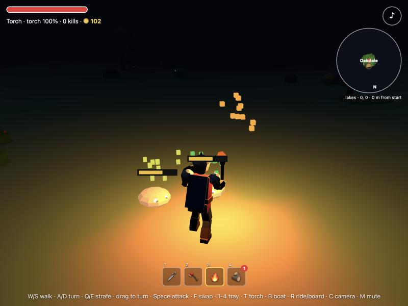

# Wellfire

**Play:** https://benallfree.github.io/wellfire/

A small js13k-style three.js action game: a warrior roams an endless seeded world of meadows, forests, rocky hills
and lakes, fights slimes, goblins, spiders, bats and eels, rides steeds, drakes and a roc, and relights the
beacons on five villages' wells to blind the star that watches from the sky.

The experiment behind it: what if js13k measured entries with [surprisal](https://github.com/benallfree/surprisal), a
language-model compressor, instead of zip? Then readable source *is* the compact form, so nothing is minified or
mangled, and every model, animation and song is plain text compiled in the page at load. The game is checked against the
13,312-byte budget under surprisal and against the best conventional pipeline (terser, roadroller, Zopfli zip).



<sub>The screenshot is from an earlier build; the HUD and help line have changed since.</sub>

## Quick start

```bash
npm install
npm start           # builds dist/index.html and serves it at http://127.0.0.1:8713 (PORT to change)
npm run ship        # build, js13k baseline, then surprisal -3 --compare against the budget
npm run ship -- -6  # the same at another surprisal level (-0..-9)
npm run baseline    # build and pack the baseline only: terser -> roadroller -> advzip
```

three.js comes from a pinned CDN, so you need a network connection. The baseline needs `advzip`
(`brew install advancecomp`). `ship` uses `/Volumes/Code/repos/surprisal/bin/surprisal` unless `SURPRISAL` points
elsewhere. `/tools/viewer.html` (dev only) shows any model, seed, clip or held item, e.g.
`?m=goblin&seeds=1,2,3&clip=walk`, and the page exposes `window.game` for the console.

## Controls

| key | does |
|---|---|
| W/S or ↑/↓ | walk forward and back (on a mount: run and back up; holding a beam: tilt it) |
| A/D | strafe (on a mount: turn) |
| ←/→ | turn |
| click | lock the mouse (Esc lets go). Sideways turns you (in first person up/down also tilts the view); a click attacks |
| C | toggle first person. The arrows then look around (left/right turn you or your mount, up/down tilt the view). Dragging with the mouse button held looks too (for browsers that won't lock). Caves are always first person |
| Space or J | use what's in hand: swing a weapon, drink a potion, blow the whistle, throw wood or flint; at a well, set or take the beam |
| F or Tab | swap to the next item (the torch isn't in the swap: it has its own hand) |
| 1–8 | pick a tray slot (sword, axe, torch, wood, flint, speed potion, healing potion, whistle). The torch slot (3) lights the torch in the left hand, or puts it out, and leaves the weapon in the right |
| 0 | crafting (in a village) |
| R | ride or leave a mount, let go of a beam |
| N | the big map (Esc closes it) |
| M or ♪ | sound on and off |

On a touch screen: drag anywhere (up/down walks, sideways turns), the HIT, SWAP and RIDE buttons, and tap a tray slot.

## The game

- **Getting by.** Health comes back in villages, not in the wilds; out there you eat berries from bushes (a tenth of
  your health, regrowing in 4 minutes) or drink healing potions. Kills spill gold; swinging the axe fells trees for wood and
  breaks rocks for coins or, about one time in three, flint. In a village you craft: a torch from a wood and a
  flint, plus wood, flint and the roc's whistle for gold and wood. Townsfolk talk.
- **The apothecary**, the first house in each village (a big bottle by its door), sells two potions: healing (250
  gold, +30 health) and speed (150 gold: 1.6× walking and swimming speed for 30 s, not on a mount; a teal bar under
  the torch's counts it down). Inside, both stand on the floor beside the shopkeeper: walk up to one and press Space to buy it.
  Drink either from the tray like any item (Space).
- **Night.** A 3-minute day. Nights are near-black, so the torch matters. It's carried lit in the left hand, beside
  your sword or axe (there's no shield), and does no damage itself: it lights the way, scares slimes and spiders back
  (bats are drawn to it, and bosses don't care), stays lit on a mount, and burns down in 90 seconds.
- **Caves.** Each village has a cave out in its wilds, sealed by a boulder that takes 8 axe blows. Inside, with a lit
  torch, is a seeded 6×6 maze of dead ends with roamers, and in its farthest cell a sunstone guarded by six
  creatures and a boss. The sunstone is yours once its guard is dead (roamers don't count), and taking it wakes the cave: every creature
  left comes hunting you on the way out. You can carry only one sunstone at a time. While you carry it, creatures
  everywhere spot you from twice as far and don't shy from your torch, and if you fall, it goes back to its cave,
  guard and all, to be won again. A village's sage says where its cave is.
- **Wells and beams.** At a village well, Space sets a torch and a sunstone in its beacon and hands you the beam: turn
  and tilt it until it snaps gold onto the star. A `✦` on the minimap rim shows the star's way.
- **Sky stages.** Each locked beam turns the sky a new colour (green, violet, orange, red) and makes the wilds harder:
  tougher, faster, keener creatures in bigger crowds, paying more gold. Caves add one guard and one roamer per locked
  beam.
- **Near home** (Oakdale, where you start and wake after a fall) the wilds are thinner and tamer, ramping to full
  strength 400 units out.
- **Getting around.** Steeds and drakes roam the wilds to be ridden (a drake breathes fire); a speed potion hurries you along;
  the whistle calls a roc that flies high and fast on its stamina, out of every creature's reach, and leaves after
  each flight, or a minute after the call, ridden or not (a ridden roc comes down and sets you off).
- **The hint line**, just above the tray. In yellow, the move you can make right here (ride, talk, crack the
  boulder, go into the cave, eat berries, break a rock, set or aim at a well, buy a potion), each gone for good once
  you've made it. In white, the mission, with an arrow that turns to point the way: step by step until you set your
  first sunstone in a beacon (find the cave, crack the boulder, go in with a lit torch, find the sunstone and beat its
  guard, take it out and back to the well, set it), and after that you're on your own (the townsfolk still tell the way).
- **Eyes, without end.** Five beams on the star shatter it in a light show, with a card of what you did. Then another
  eye opens somewhere else in the sky. The sky clears to the first stage, and you keep everything you carry. The old
  beams stay lit, pointing where the dead eye hung, and their wells and caves are spent, so each eye takes five new
  villages. Each eye's creatures are a quarter tougher and richer than the last (models.json `eye.harder`).
- **Names.** A village's name comes from its map cell alone (models.json `towns`): a first part, an optional middle and
  an ending, each stepping along its list by a fixed amount per cell. So about 4,000 names never repeat within 24 cells
  either way, and neighbours never share a first or last part. One village in six also gets a first word (Upper, Lower,
  Great, Little, Old, New, East, West). Each mount's name is two halves rolled from its seed (its `name` var is a list
  of option strings, one of each joined), 256 per kind.

Progress (the map, felled trees and rocks, opened caves, sunstones, beams, the eye you're on, the bag) is saved in `localStorage`.

## How it's built

- **Models are text.** `src/models.json` holds every model, skeleton and animation clip as pretty-printed JSON:
  primitives (box, ball, cylinder, lathe, extrude) on bones, with mirroring, seeded ranges and picks, so each creature
  block is a generator of endless variants. `src/compiler.js` turns them into rigged three.js meshes at load (one
  merged mesh per bone, no skinning). Gameplay tuning lives in the same file: `health`, `stages`, `wilds`, `rocks`,
  `berrybush`, `caves`, `tray` (slots and recipes), `talk`.
- **Music is text too.** `src/score.json` is compiled and synthesized with WebAudio by `src/music.js`. There are no
  binary assets: no textures, meshes or audio files.
- **One file.** `tools/build.mjs` concatenates `compiler.js`, `music.js` and `game.js`, strips comments
  (`tools/strip.mjs`; they stay in the source), and inlines both JSON files into `dist/index.html`.
- **Data as pretty JSON**, not a custom DSL: it packs smaller under surprisal despite being bigger raw
  ([docs/json-vs-dsl.md](docs/json-vs-dsl.md)).
- **Build tag.** The build stamps its commit (plus `+` for uncommitted changes in `src/`) in the page's bottom-right
  corner, to tell a cached page from the latest.
- three.js r170 (`three@0.170.0`) loads from jsDelivr through a pinned import map and doesn't count toward the budget.

## Size

Last measured on `main` at `ee8a327` with `npm run ship -- -6`:

| pipeline | bytes | of 13,312 |
|---|---:|---:|
| surprisal `-6` (`dist/index.13k`) | **13,090** | 98.3% |
| terser + roadroller + advzip (`dist/roadroller/index.zip`) | 38,099 | 286% |

The compression level is saved in `package.json` under `"size"`, together with the budget (13,312) and the headroom
(200 bytes) the build should keep below it.

- `npm run ship` builds, packs the roadroller baseline and compresses at the saved level. `npm run ship -- -N` (or
  `npm run ship -N`) uses level N for that run only.
- `npm run fit` builds and compresses at the saved level. While the archive is over budget minus headroom, it steps
  up one level at a time, up to `-9`. It saves the first level that fits and prints a table of every level it tried.
  If even `-9` is over, it leaves `package.json` unchanged and exits 1. Pass `npm run fit -- --down` to also step
  down while lower (faster) levels still fit. `fit` skips the baseline.

Higher levels are slower. `-6` takes a few minutes on the GPU, and `-9` much longer. The baseline takes about 15
seconds. `ROADROLLER_O` and `ADVZIP_ITER` tune the baseline. `npm run size` prints a fuller report across formats.

## Deploy

`.github/workflows/pages.yml` builds `dist/` and publishes it to GitHub Pages on every push to `main` (or by hand via
workflow dispatch). The deploy step occasionally fails on GitHub's side with "No artifacts named github-pages";
re-running the job fixes it.

Every build is versioned: the corner of the game shows `<version>-alpha.<commits> · <commit>`, for example
`1.0.0-alpha.120 · 8ab1f07`. `<version>` is `version` in `package.json`; the alpha number is the commit count, so each
deploy from `main` shows a higher one. The workflow checks out the full history
for that count. A `+` after the commit means a local build with uncommitted changes in `src/`.

## History

[docs/postmortem.md](docs/postmortem.md) is the full development journal: every feature as it was built, the design
choices and the experiments, with costs and measurements as they were at the time. Related write-ups:
[json-vs-dsl](docs/json-vs-dsl.md), [refactor-size](docs/refactor-size.md), [goal-ideas](docs/goal-ideas.md),
[world-layers](docs/world-layers.md).
