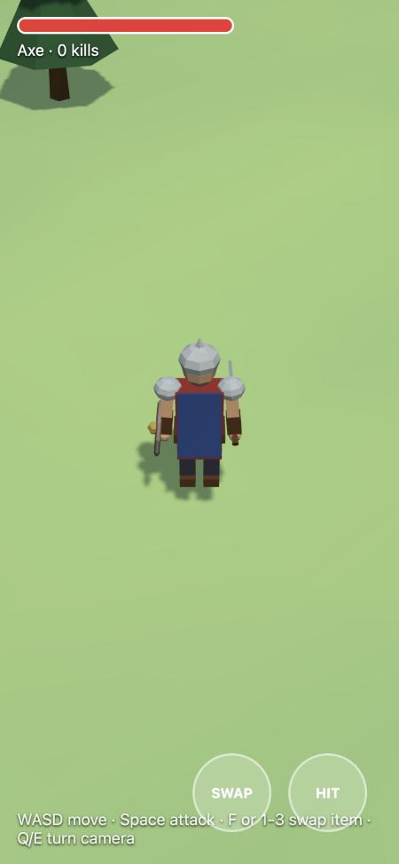
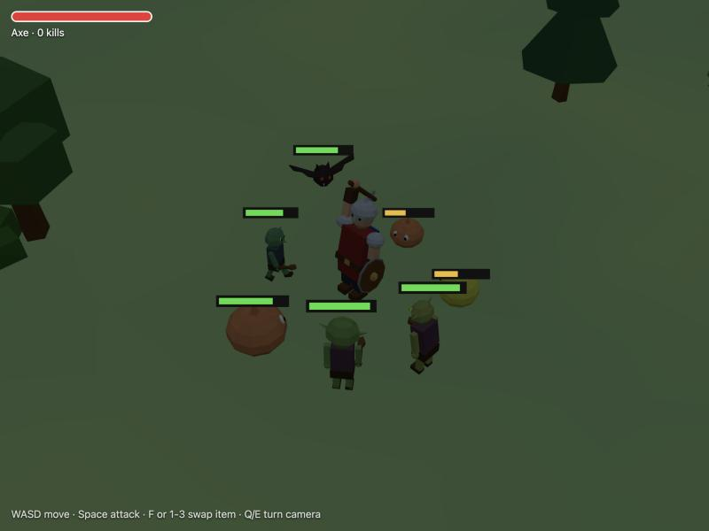
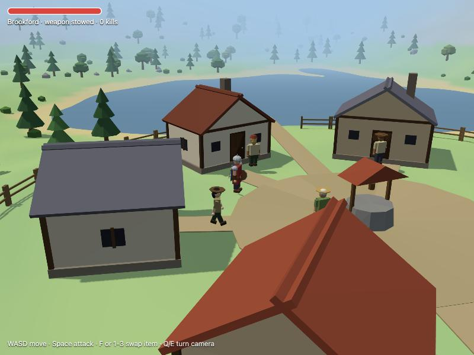
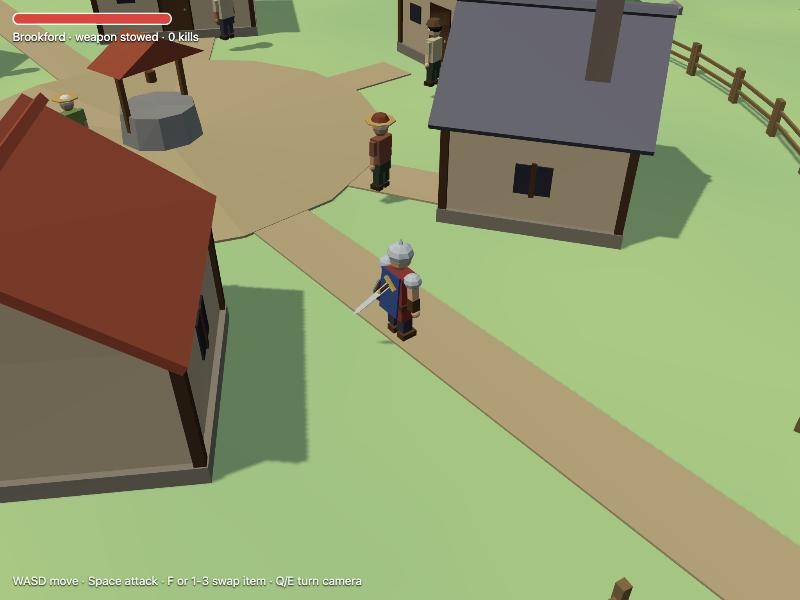
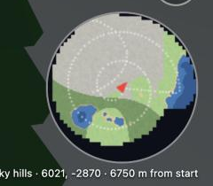
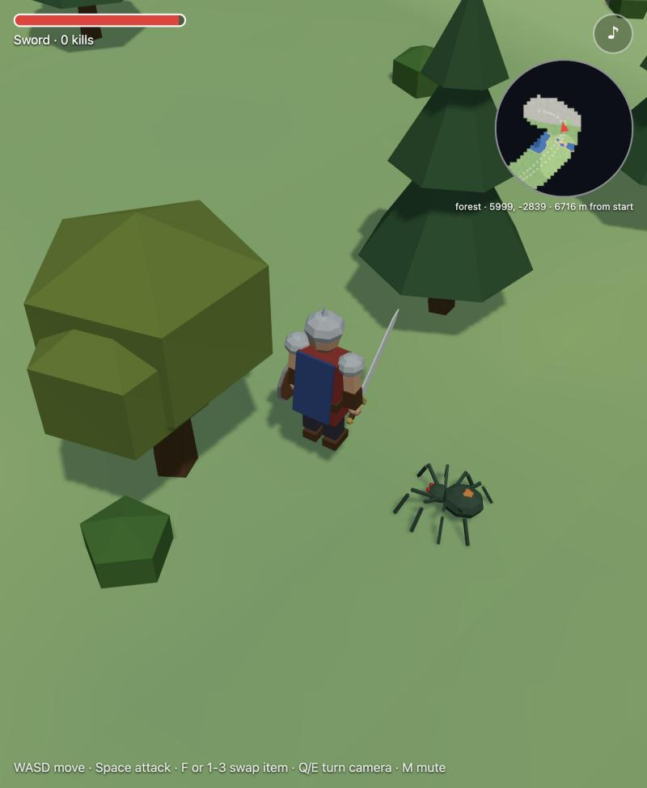
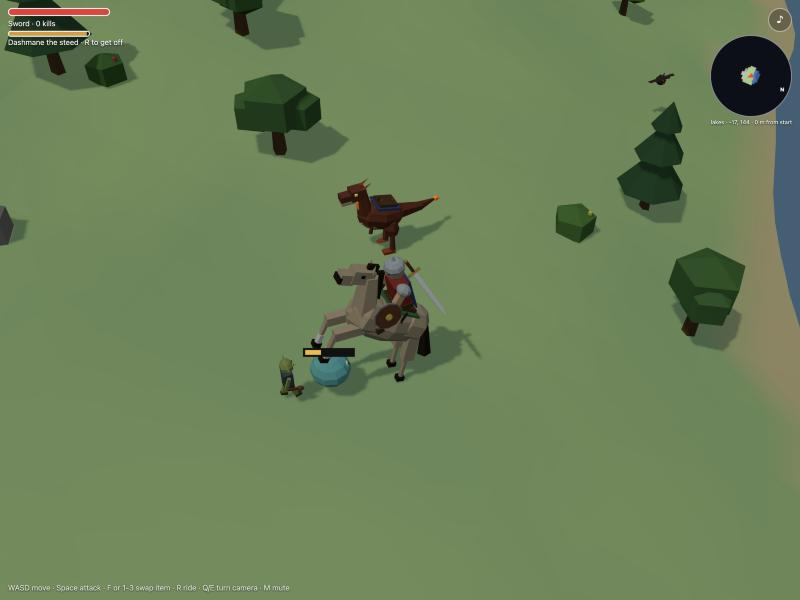
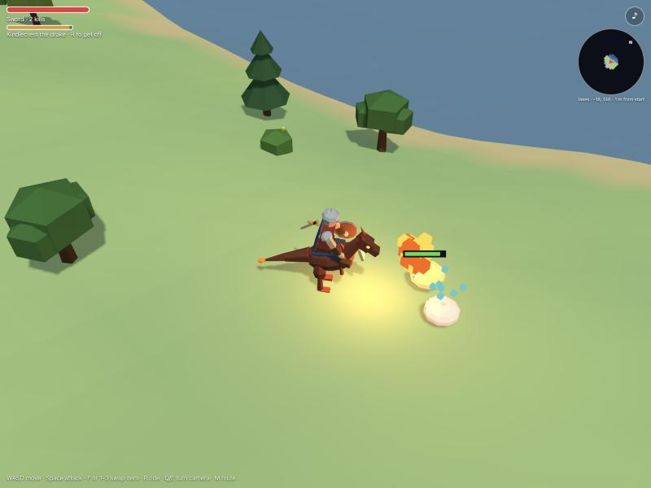

# Warrior: a 3D js13k spike measured with surprisal

A small third-person action game: a warrior runs around a seeded open world fighting slimes, goblins, spiders and bats
with a sword, an axe or a torch. Every model in it (the warrior, the props, the creatures, the trees) is **text** (plain
JSON), and the compiler that turns it into rigged three.js meshes ships in the same page. The question behind it: if js13k
measured entries with [surprisal](https://github.com/benallfree/surprisal) (a language-model compressor) instead of
zip, what does a "language + JIT" architecture buy you?

```bash
npm install && npm start
```

Then open http://127.0.0.1:8713. (`npm start` builds `dist/index.html` and serves it; three.js comes from a CDN, so you
need a network connection.)

**Controls:** WASD or arrows move · Space or J attack · F, Tab or 1-3 swap the item in hand · Q/E turn the camera · M or the ♪ button toggles sound.
On a touch screen: drag anywhere to move, plus HIT and SWAP buttons.

| | |
|---|---|
|  |  |
|  |  |
|  |  |
|  | |

## Results in one paragraph

The whole game, readable and unminified, is about 33 KB in one HTML file. Surprisal at level 1 packs it to about 3 KB
(32,727 → 3,033 bytes, 90.7%), under a quarter of the 13,312-byte budget. The model text on its own (5,140 bytes for
the characters and props) packs to 916 bytes. So the budget is not the constraint here: by the working rule of thumb
of **~90% under surprisal**, this architecture leaves room for roughly four times as much game. I stopped measuring
after those spot checks and used that ratio while building; the full table below is a tool you can run, not
something I ran to completion. (Those numbers predate the switch from the text DSL to JSON models, which made the
compiler + models bundle 170 bytes smaller under surprisal: see [docs/json-vs-dsl.md](docs/json-vs-dsl.md).)

## Architecture

```
src/models.json  all models, skeletons and animation clips, as pretty-printed JSON (~42 KB raw, ~1 KB packed)
src/compiler.js  the compiler + rig runtime: JSON -> three.js bones, merged meshes, clips (~8.4 KB)
src/score.json   the music: voices and sections as pretty-printed JSON, note patterns as strings (~3.8 KB)
src/music.js     the score compiler, synthesized instruments + WebAudio sequencer (~16 KB)
src/game.js      world, actors, combat, AI, camera, input, HUD (~17 KB)
src/index.html   page shell: HUD markup, import map for three.js
tools/build.mjs  inlines everything into one file: dist/index.html (the shipped artifact)
tools/size.mjs   the size report (below)
tools/formats.mjs  JSON vs. the old text DSL and other formats under surprisal (docs/json-vs-dsl.md)
tools/viewer.html  dev-only model viewer: /tools/viewer.html?m=goblin&seeds=1,2,3&clip=walk
```

The game is **one HTML file**. The build inlines `models.json` as a `<script type="application/json">` block and `score.json`
the same way, and concatenates `compiler.js`, `music.js` and `game.js` into one module script. At load time the page parses the models, compiles what it needs, and
starts. There is no binary asset anywhere: no textures, no meshes, no audio files (the music is compiled from
`score.json` and synthesized with WebAudio; effects are oscillator blips).

**three.js** is r170 (`three@0.170.0`), loaded from jsDelivr through a pinned import map. It does not count toward the
budget. The game leans on it heavily on purpose: `BoxGeometry`, `SphereGeometry`, `CylinderGeometry`,
`LatheGeometry` and `ExtrudeGeometry` are the format's primitives, so the compiler is mostly a transform stack. `npm install` only pulls three.js so Node can run the same compiler for the size report.

## The model format

> The models were first written in a custom line-based DSL (`box chest cloth 0 .27 0 .46 .55 .28`). Measuring showed
> that the same content as plain pretty-printed JSON packs about 10% smaller under surprisal, and the whole
> compiler + models bundle smaller too, even though the JSON is seven times bigger raw. So the game now ships JSON. The
> comparison, and the old DSL with its compiler, are in [docs/json-vs-dsl.md](docs/json-vs-dsl.md) and `tools/formats/`.

Prior art I weighed:

- **OpenSCAD-style CSG** (primitives, transforms, boolean ops): very compact, but real booleans need a mesh CSG
  library, which is a lot of code to ship. Low-poly characters don't need booleans; overlapping solids look the same.
- **SDF / implicit modeling** (Inigo Quilez style, demoscene raymarchers): the most compact text of all, and smooth
  blends look great, but you then need marching cubes or a raymarcher, it's slow to mesh at load time, and rigging an
  SDF means re-meshing per bone.
- **Demoscene mesh generators** (operator stacks like .kkrieger's): powerful, but the operator graphs are binary or
  near-binary, which is exactly what doesn't compress under surprisal.
- **Voxels**: trivially simple to interpret, but voxel models are grids of data, closer to binary than to language.

I picked **primitives with transforms, mirroring, bones and a few generative tricks**: the cheapest to interpret
(three.js does the geometry), naturally skeletal (every part names the bone it rides on), and written in a form a
language model predicts well. `src/models.json` maps each model name to a block like this (shortened; the file is
`JSON.stringify(models, null, 2)`, which puts every array element on its own line):

```json
"warrior": {
  "vars": { "cloth": "9b2f2f", "steel": "bcc6d0" },
  "bones": [
    { "name": "arm*", "parent": "chest", "position": [0.3, 0.52, 0] },
    { "name": "hand*", "parent": "arm*", "position": [0, -0.55, 0.02], "rotation": [-25, 0, 0] }
  ],
  "parts": [
    { "shape": "box", "bone": "chest", "color": "cloth", "position": [0, 0.27, 0], "size": [0.46, 0.55, 0.28] },
    { "shape": "ball", "bone": "head", "color": "steel", "position": [0, 0.25, 0], "size": [0.2, 0.15, 0.2], "segments": 8 },
    { "shape": "ball", "bone": "head", "color": "222", "position": [0.065, 0.19, 0.14], "size": [0.025, 0.03, 0.02], "mirror": true }
  ],
  "holds": [{ "bone": "handL", "model": "shield" }],
  "clips": {
    "walk": { "duration": 0.7, "loop": true, "channels": [{ "bone": "leg^", "channel": "rx", "keys": [35, -35] }] },
    "swing": { "duration": 0.45, "loop": false, "channels": [{ "bone": "armR", "channel": "rx", "keys": [0, -170, -40, 0] }] }
  }
}
```

| field | meaning |
|---|---|
| model name | a top-level key. `common` holds clips every model inherits unless it defines its own. |
| `vars` | variables. A value may be a number, `"a~b"` (seeded random in [a, b]), an expression (`".3*s"`), a color, a name, or `"a\|b\|c"` (seeded pick). |
| `scale` | scale the whole model (number or expression). |
| `bones[]` | `name`, `parent`, `position`, optional `rotation` (degrees). A name ending in `*` makes a mirrored L/R pair (L at +x, R at −x, rotations mirrored); a `parent*` resolves per side. |
| `parts[]` | `shape`, `bone`, `color`, `position`, `size`, optional `rotation`, `segments`, `mirror`. Shapes: `box` size `w h d`; `ball` (ellipsoid) `rx ry rz`; `cyl` `rTop h rBottom` (a cone when rTop is 0); `lathe` `r y r y ...`; `ext` `depth x y x y ...` (an extruded polygon). `mirror: true` also adds the part's mirror image (two eyes, one entry). |
| color | 3- or 6-digit hex string, a variable, or a `\|` pick. A trailing `!` makes it glow (the torch flame). |
| `holds[]` | `bone`, `model`: attach a prop model to a bone (a socket). `"club\|spear"` picks one per seed. |
| `chance` | on any bone, part, hold or channel: keep it with that probability (optional parts). |
| `repeat`, `var` | on any bone, part, hold or channel: repeat it `repeat` times with `var` = 0..n−1. `"{expr}"` inside a string is evaluated, so names like `"leg{i}*"` and positions like `"{.2-i*.12}"` work. |
| `clips` | `name: { duration, loop, channels }`. A channel is `bone`, `channel` (`rx ry rz` degrees, `x y z` offset, `s` or `sx sy sz` scale offset) and `keys`, evenly spaced and smoothstep-interpolated; loops wrap. `bone*` mirrors, `bone^` mirrors half a cycle out of phase (walk cycles). |

Numbers anywhere can be expressions over variables (strings), so a goblin's ears follow its random head size
(`"position": [".24*h", 0.25, 0]`). Variables also carry gameplay data: a prop's `"dmg": 6`, `"reach": 2.3`,
`"push": 12`, `"anim": "chop"` are read by the game when you equip it, so an item is entirely defined by its block.

## Compiler and rig

`make(lib, name, seed)` in [src/compiler.js](src/compiler.js) walks a model's block in order (vars, bones, parts, holds, clips) with a seeded random generator:

1. Bones become `Object3D`s in a hierarchy under the model's root; their rest transforms are recorded.
2. Each shape becomes a three.js geometry, rotated and translated into its bone's space, stripped to positions, and
   given per-vertex colors (with a little per-face shade jitter for the faceted look). Mirrored copies flip x and
   reverse the triangle winding.
3. All parts on one bone merge into **one mesh per bone**, sharing one flat-shaded Lambert material per model
   instance (so a monster can flash red without affecting others).
4. `hold` builds the prop model and parents it to the bone.

There's no skinning: parts are rigid on their bones, the classic low-poly look, and it means no weights to store.
`pose(model, layers)` resets every bone to rest and adds each clip layer's channels on top, weighted. The game blends
`idle` and `walk` by speed and lays a one-shot (`swing`, `chop`, `jab`, `attack`, `hit`, `death`) over them. Held
props run their own `idle` clip, which is how the torch flame flickers. Static models (trees, rocks, bushes) are baked
to one geometry per seeded variant and drawn with `InstancedMesh`: 16 variants, refilled as world chunks come and go.

**Props and sockets.** A socket is just a bone. The warrior's `hand*` bones carry a shield on the left (`hold handL
shield` in the warrior's own block) and whatever the player equips on the right; swapping calls `hold()` again, which
detaches the old prop and compiles the new one. Goblins use the same mechanism to carry a club or a spear. A prop's
origin sits in the fist, and each prop orients itself in its own block with a rotated root bone (the sword's bone `g`
on `root` with rotation `[-10, 0, 0]` tips the blade up and forward; the axe pitches its haft down so the edge leads
the chop); the swing clip also snaps the wrist (a `handR` `rx` channel) so the blade comes down level at the end of
the cut.

**Deterministic creatures.** The slime, goblin, spider and bat blocks use `~` ranges, `|` picks, `chance` optional
parts and `scale`, so every seed is a different, repeatable creature: size, color, head size, horns, hats, markings,
weapons. Monster stats scale with the compiled size. The world itself is seeded too, and endless (see
[Endless world](#endless-world)).


## The game

Third-person, high three-quarter perspective camera that trails the player (Q/E rotate it). An endless seeded world
of meadows, forests, rocky hills and lakes, with an exploration minimap, and a 3-minute day/night cycle (the torch earns
its place at night). Twelve to twenty-odd monsters at a time wander, chase within 12 units, wind up and strike; you get knocked back and flash, they get knocked
back, flash, and burst into little cubes. The sword is quick, the axe is slow and heavy with big knockback, the torch
does little damage but sets monsters alight; burning monsters flee and take damage over time. Steeds and drakes can be
found and ridden (see Mounts). Dead monsters shrink away
and respawn somewhere around you; you regenerate slowly, and if you fall you get back up at the start.

## Music

The background music is text too: [src/score.json](src/score.json), compiled at load by
[src/music.js](src/music.js) and played by a small WebAudio sequencer. Up to fourteen voices sound at once (lead or bell,
arpeggio, pad chords, bass, kick, hi-hat, and a part for each kind of monster), all synthesized in code: no samples, no
audio files. See **Instruments** below for how each one is built.

Prior art I weighed: **ZzFXM** and **Soundbox** (the js13k standards) store patterns as arrays of numbers, compact for
zip but close to binary, which is what surprisal can't predict. **Tracker patterns** read well as a grid but spell out
every note. **ABC notation** is readable text but its full grammar (lengths, ties, keys, repeats) is a lot of parser.
I took the tracker's grid (one token per step, voices lined up) and ABC's note letters, and added one idea from lead
sheets: a **chord track**. Bass and arpeggio lines are written as chord tones (`1` root, `2` third, `3` fifth, `4` root an
octave up, ...), so one short line plays over any progression, and a new section only needs new chords and a melody.

The file follows the models' format choice ([docs/json-vs-dsl.md](docs/json-vs-dsl.md)): pretty-printed JSON with
named keys, because under surprisal the keys are nearly free and tell the model what each number is. The note patterns
stay strings: a pattern is the notation itself, the tokens are letters rather than numbers, and one string per part keeps
the bars readable. (An earlier version was a line-based text format with the same patterns; the JSON compiles to
identical notes and packs smaller: 392 → 265 bytes for the score alone at surprisal -1, despite being 60% bigger raw.) Abridged:

```json
{
  "tempo": { "bpm": 104, "stepsPerBeat": 2, "beatsPerBar": 4 },
  "order": { "day": ["A", "A", "B", "A"], "night": ["N", "N", "M", "N"] },
  "voices": {
    "bass": { "wave": "bass", "octave": 2, "volume": 0.036, "attack": 0.005, "release": 0.12, "reverb": 0.1 },
    "arp": { "wave": "pluck", "octave": 4, "volume": 0.24, "attack": 0.002, "release": 1.2, "bright": 0.55, "pan": -0.35, "calm": true },
    "boing": { "wave": "marimba", "octave": 4, "volume": 0.27, "attack": 0.002, "release": 0.5, "monster": "slime" }
  },
  "allSections": { "boing": "1,4 . . 1,4 . . 3,5 ." },
  "sections": {
    "A": {
      "chords": "C G Am F",
      "parts": {
        "lead": "e . g . c6 - b . | b - g - d - . . | c . e . a - g . | a - g - f - . .",
        "bass": "1 . . 1 3 . 1 .",
        "pad": "* - - - - - - -",
        "hat": ". x . x . x . x,x"
      }
    },
    "B": { "base": "A", "chords": "F G Em Am", "parts": { "lead": "f . a . c6 - a . | ..." } }
  }
}
```

(The real file is `JSON.stringify(score, null, 2)`, so arrays and objects are expanded one item per line.)

- `tempo`: a step is one eighth note at 104 bpm; a bar is 8 steps.
- `order`: the sections played by day and after dark, looping.
- `mix`: the level of the whole music bus, set so the music sits under the game's sound effects.
- `voices`: `wave` (the instrument), `octave` (for notes without one), `volume`, `attack` and `release` in seconds
  (release is also the damper on struck and plucked notes, and how long their buffer rings), optional `filter` in Hz
  (low-pass, or high-pass on `hat`), `pan` (-1..1), `reverb` (send level, default 0.25), `chorus: true` (ensemble
  chorus), `bright` and `sustain` for `pluck` (excitation brightness 0..1, per-period loss), and either `calm: true` (ducks while monsters are near) or `monster: "<kind>"`
  (silent until that kind is near).
- `allSections`: parts that join every section (the monster parts).
- `sections`: `chords` (one chord per bar; `"C,G"` splits a bar), `parts` (voice name to pattern), and an optional
  `base` section whose parts it starts from. A pattern shorter than the section repeats.

Pattern tokens, separated by spaces:

| token | meaning |
|---|---|
| `c` `f#` `bb` `a4` | a note; the digit is the octave, otherwise the voice's octave |
| `1`..`9` | a tone of the current chord, counted up from the root in the voice's octave |
| `*` | the whole current chord |
| `x` `o` | a drum hit, `o` louder (any token hits on a `noise` or `kick` voice) |
| `-` | hold the previous note one more step |
| `.` | rest |
| `a,b` | split one step (or one bar, on the chord line) evenly between tokens |
| `\|` | bar line, ignored |

Waves are the instruments below, or any oscillator type (`sine`, `square`, `sawtooth`, `triangle`) with a plain
envelope. Drums are `kick`, `taiko`, `snare` and `hat`. Chords are a root, optional `#`/`b`, optional `m`, optional `7`.

**Instruments.** The first version played raw oscillators with on/off envelopes (full level until the note ended), no
filter movement, no variation between notes, dry and in mono, which is what made it sound like a chip tune. Each
instrument is now a small synthesis recipe, picked for what makes that instrument recognisable:

| wave | used by | how |
|---|---|---|
| `flute` | lead (day melody), flutter (bat) | a sine-ish wave (a few soft harmonics) with a breath-noise chiff on the attack and vibrato that fades in only on held notes |
| `pluck` | arp (harp), crawl (spider pizzicato) | Karplus-Strong: a noise burst circulating in a one-period delay line that is averaged every pass, with fractional-delay tuning so high notes stay in tune |
| `bell` | bell (night melody) | inharmonic partials (1, 2, 3.01, 4.17, 5.43) with the high ones dying first, plus a beating copy of the fundamental; each partial is a two-pole resonator so a pitch renders in a few ms |
| `strings` | pad | three detuned saws per note, a low-pass that opens over the slow attack, and a shared ensemble chorus (two LFO-swept delays panned apart) |
| `brass` | riff (goblin) | two saws that scoop up into pitch, through a low-pass that blares open on the attack and settles |
| `bass` | bass | a saw plus a sine under a filter that snaps shut: a round, plucked bass |
| `marimba` | boing (slime) | a mallet sine whose pitch drops into place, plus a fast-dying fourth partial |
| `taiko` / `kick` | kick (frame drum), wardrum (goblin) | a pitch-swept sine with a noise click (kick) or a dark skin-noise layer (taiko) |
| `snare` / `hat` | snare, hat, tick | a two-mode tone body plus high-passed noise; hats are high-passed noise whose decay is the voice's release |

Struck and plucked sounds are rendered once per pitch into a cached AudioBuffer. Every pitch the score uses is
pre-rendered, one per scheduler tick, so a first note never stalls a frame. Held sounds are live oscillator graphs a few
nodes deep. Every note is humanized: up to 6 ms of timing slop, ±12% velocity with lighter off-beats, and a few cents of
pitch drift (drums ±30 cents, as hand drums vary). All voices share one convolution reverb, whose impulse is
generated noise that decays and darkens as it fades, plus a stereo pan per voice. The master chain is the night low-pass,
a 30 Hz rumble and DC cut, a gentle compressor (3:1 from -20 dB), and `mix` (0.6). The music now sits about 2 dB under
its old level, so the combat blips cut through.

Cost: `music.js` grew from 7,928 to 16,489 bytes raw (+8.6 KB) and the score's voice settings from 3,759 to 4,170
(+0.4 KB). At the ~90% the project assumes for surprisal, that is roughly +0.9 KB shipped. At runtime a scheduler tick
averages under 1 ms (about 0.1 ms once the buffers are warm), measured in Chrome with every monster part playing. Before
and after renders of each section, made with an OfflineAudioContext (12 s each, AAC), are in
[docs/audio/](docs/audio/): `A-before.m4a` / `A-after.m4a` and the same for `B`, `N` (night), `M`, and `monsters` (section
A with every monster part in).

**Compiler and player.** `score()` parses the JSON and compiles every section into per-step event lists with notes
already resolved to frequencies and lengths, so the runtime never parses. `sequencer()` is the classic lookahead
scheduler: every 50 ms it schedules the steps that start in the next 250 ms on the audio clock, so timing stays
sample-accurate and sections loop without a seam. The same function renders into an `OfflineAudioContext`, which is how
I checked levels and seams without listening.

**It follows the game.** When the light drops, the player switches to the night order at the next bar line (the same
bar of the new section) and a master low-pass filter darkens the mix. The tempo never changes: the music reacts by
changing which parts play, not how fast.

**Every monster kind has its own part.** A voice tagged with a monster kind fades in while
one of that kind is within 14 units and fades out (more slowly) once none is, so you can hear what's coming before you
see it, and a mixed pack stacks its parts:

| monster | part |
|---|---|
| slime | `boing`: bouncing marimba octave leaps |
| goblin | `wardrum`, `snare`, `riff`: a marching war-drum beat under a low brass riff |
| spider | `crawl`, `tick`: a skittering 16th-note pizzicato arpeggio over clicking legs |
| bat | `flutter`: a high flute trill |

The parts are written in chord tones, so they fit every day and night section. Voices tagged `calm` (the arpeggio) duck
out while any monster is near. The parts sit in the mid and high range on purpose: a first version used one shared
fight layer that was mostly bass, which laptop speakers barely play, so it went unheard. Audio starts on the first key, click or touch (browsers require a gesture); muting suspends the AudioContext, so the scheduler pauses too,
and the choice is remembered. The music module, score and hooks add 12,985 bytes raw to the build and **1,044 bytes at
surprisal -1** (the whole game goes from 3,068 to 4,112 bytes). With the old text score the music cost 1,204.

## Villages



A seeded village sits about 30 units from the start: five or six houses round a square with a well, dirt paths to each
door, and a fence ring with two gates. Seven townspeople stroll between the doors and the well and stop to idle. Walk
in and the warrior hangs the weapon on his back (each item is aimed by its own shape: its longest end points down,
a torch's flame up); attacking is disabled and the HUD shows the village's name. Walk out
and the weapon is back in hand. Monsters don't spawn inside, stop chasing once you're in, and are pushed back at the
fence, so they wait at the edge. Walk into any door: the screen fades to black and you're inside, by the fire. Walk
back out of the door and you're outside again, in front of it.

| weapon stowed | inside a house |
|---|---|
|  |  |

How other games do this cheaply, and what I picked:

- **Zones.** MMO sanctuaries and towns are just a radius check. Monsters "leash": they give up the chase at the
  boundary. Here the village is a circle: inside it you stow the weapon, monsters drop the chase, and a collider keeps
  them outside the fence.
- **Interiors.** The usual options are a streamed separate map behind a load door (Zelda, Pokémon, Skyrim), a roof
  that lifts off when you step in (Ultima VII, Fallout 1/2), or a cutaway room with the near walls cut low (The Sims,
  Diablo). I picked a **door warp with a fade to black, into a cutaway room**. Each room is built under its house, 40
  units and more below the ground, where the terrain hides it. The same scene, renderer and `Actor` movement apply,
  with no scene swap and no streaming. The fade hides the jump. Inside, a fixed camera looks in over a low front wall,
  so no wall-occlusion code is needed, and the sky turns black, the sun goes off and the hearth's light comes up.
  A roof lift-off would need real interiors inside every house shell and a camera that copes with walls.
- **Houses in the way.** Outside, a house between the camera and the player fades see-through (Diablo-style), so the
  warrior is never lost behind a roof.

The models are JSON in `src/models.json` like everything else: `villager` (the warrior's skeleton with seeded skin, shirt, trousers, hair,
optional apron and straw hat, and seeded build), `house` (seeded width, depth, wall height, roof pitch and colours,
with gable, slanted roof, timber frame, door, windows and an optional chimney), `room` (seeded size and colours, with
bed, table and stools, hearth with a glowing fire, bookshelf, rug, and optional barrels and a crate), and `well`,
`fence`, `plaza` and `path`. The layout (where houses go, which way they face, the paths, the fence and its gates, the
name, e.g. "Brookford") is generated in `game.js` from a seed. The terrain is levelled under the village by blending
`height()` toward the site's height.

**Model format additions: none.** Solid house shells plus separate rooms meant no hollow boxes or door cutouts. A door
is a dark box on the front wall, a gable is an `ext` triangle, and the roof slopes are boxes whose angle is an
expression (`"{Math.atan2(r,w/2)*57.3}"`). The existing variables, `a~b` ranges, `|` picks and `chance` parts covered
all the variation. (The village models were first written in the old DSL and converted with `parse()` from
`tools/formats.mjs`, the same converter that produced the rest of `models.json`.)

Code hooks outside the village blocks are small, so they should merge cleanly with other work on `game.js`:
`height()` returns through `flatten()`; `Actor.move` runs a `blockers` list of extra colliders; `Actor.update`
respects `actor.floor` (the room's floor); `equip`, `attack`, `hud` and monster chasing check `village.in`; and the main
loop calls `village.update(dt)` before the health bars and rendering.

Cost: about 32.6 KB raw (game code +10.9 KB, model JSON +21.7 KB). Not measured with surprisal. At ~90% for code
and the ~97% that `models.json` packs to overall, that's roughly 1.1 KB + 0.6 KB, so about 1.7 KB shipped.

## Endless world


There is no edge. The world is a pure function of `SEED` and coordinates, so any place regenerates identically on
every visit and every page load, and nothing generated needs storing. It's one self-contained block in
[src/game.js](src/game.js) (`// ---------- world`):

- **Noise.** `hash(x, z, seed)` is an integer hash (`Math.imul` mixing), so it stays exact at any coordinate (the old
  `sin()` hash loses precision far out). `noise()` is smooth value noise on it.
- **Regions.** Two slow fields, `wet` and `rough` (a feature every few hundred units), pick the region: **meadow**,
  **forest**, **rocky hills** or **lakes** (`region(x, z)`, each about a quarter of the world). `height()` is four
  octaves of detail scaled by `rough`, lifted into hills where it's rough and sunk into lakes where it's wet; about a
  quarter of the world is water. `ground()` colours a point (sand, meadow grass, darker forest grass, rock) and is
  shared by the terrain and the minimap.
- **Chunks.** The world is cut into 40×40-unit chunks. Each frame `stream()` drops chunks more than 4 away from the
  player, builds at most two missing chunks within 3 (nearest first), and refills the scenery instances. A chunk is a
  terrain mesh (26×26 vertices, coloured per vertex) plus an instance list and colliders. Neighbouring chunks
  sample `height()` at the same edge points, so seams match exactly (checked: zero difference along a shared edge).
- **Scenery.** A chunk's contents come from `rng(hash(cx, cz))`: 70 candidate spots, each drawing a fixed number of
  random values whether or not anything grows there, so the result never depends on build order. What grows depends
  on the region (`FLORA`: dense pines and oaks in forest, boulders in rocky hills, bushes by lakes, sparse meadows). The
  16 tree, rock and bush variants are compiled once, and each is one shared `InstancedMesh` that every live chunk
  writes into, so walking around adds no draw calls (about 40 in all).
- **Water** is one flat sheet that travels with the player: the water level is the same everywhere, so this matches
  per-chunk water and costs one mesh.
- **Monsters by region.** The spawn point's region picks the kind (`FOES`: spiders in forest, goblins and bats in the
  hills, slimes by the lakes), and the player's region scales the crowd (`CROWD`: forests are busier, lakes quieter).
- **What's remembered.** Only what can't be derived: the minimap's set of revealed 8×8-unit cells (one short string
  each, a few thousand after a long walk). Everything else is rebuilt from the seed: live chunks are the 49–81 around
  you, and the minimap's chunk pictures are a 150-entry cache. Player changes to the world (felled trees, opened chests)
  would go in a similar keyed set and be applied in `grow()` after generating.

**Adding points of interest.** A village pass would ask the same seed per chunk:
`const poi = hash(cx, cz, SEED + 5) < 0.01 ? 'village' : null` gives a stable, sparse answer for any chunk, and
`grow()` (or a `feature(cx, cz)` beside it) would build it and keep scenery off it, the way it already skips `inTown()`.
The one village today is placed near the start by its own seed and levels the ground through `flatten()` inside
`height()`, so the terrain, colliders and minimap all agree with it.

**Checked in the browser** (via `window.game`, which now also exposes `scene`, `renderer` and `world`):

- Teleporting to (10000, 10000), elsewhere, and back gives the same chunk (same trees, same heights), and a fresh page
  load gives the same signature.
- After teleports to ±10 km and a 1,200-unit walk, `scene.children` stays at 85–110 and live chunks at 49–81.
  `renderer.info.memory.geometries` stays roughly flat: 171 before, 153 after the walk, 240–350 across teleports
  (live chunks plus monsters). That needed a fix in `spawn()`: monsters left behind are now disposed of (their
  geometry and material), where before every respawn leaked one compiled model. `hold()` in the compiler likewise frees the
  prop it replaces, so item swaps and village stows no longer leak (12 swaps and 5 village trips: +0 geometries).
- Frame time while walking at 40 units/s: median 8.3 ms, worst 9.4 ms (120 Hz display); chunk building never showed
  up as a hitch.

## Exploration minimap



Top right, under the mute button, a round 160-pixel map shows 320×320 units around the player at 2 units per pixel.
Ground you've been within 36 units of is drawn in the world's own colours: deep and shallow water, sand, meadow, forest
(darker), rock. The rest stays dark (fog of war). A dotted trail of your last 300 steps, a yellow square at the
start and a red arrow for your facing sit on top. Below it: the region, your coordinates and how far you are from the
start, e.g. `rocky hills · 5899, -3327 · 6860 m from start`.

It **turns with the camera**: up on the map is the way the camera looks, which is the way W walks, so the red arrow
points up when you walk straight ahead. An **N** on the rim shows where north (−z) is. (A north-up map was tried first,
but the camera's default 45° turn made "straight ahead" point northwest on the map.) The explored ground is composed
world-aligned on a slightly larger hidden canvas and drawn turned in one `drawImage`, so chunk tiles never show seams.

It's drawn on a 2D canvas without reading back WebGL. Each revealed cell is painted once into a small per-chunk canvas
by sampling `height()`, `region()` and `ground()` 16 times. Each frame the visible chunk canvases are blitted, the
trail drawn on top, and the result drawn turned by the camera's yaw. The chunk canvases are an LRU cache of 150: an evicted one is repainted from `seen` when
you come back into view, so leaving and returning shows exactly the ground you explored.



Cost: about 8.2 KB raw (game code +7.9 KB, HTML/CSS +0.3 KB), including the disposal fix and the region tables. Not
measured with surprisal; at ~90% that's roughly 0.8 KB shipped.

## Mounts


Two original rideable creatures live in `models.json`. Both are ordinary models with bones, rigid parts and keyframe
clips, a `saddle` socket bone, and their gameplay numbers in `vars`. Each one varies by seed: size, coat or scale
colours, mane, blanket and name, plus extras that roll a chance (a steed's brow horn and white socks, a drake's stubby
wings).

| | steed | drake |
|---|---|---|
| shape | four-legged, long neck, mane, saddle and stirrups | small two-legged dragon: long tail, horns, spines, embers glowing in its throat and tail tip |
| run / turn | fast: 10.5–12.5 units/s, 3.4–4 rad/s | slow: 6.5–8 units/s, 2.4–3 rad/s |
| attack | **rear and trample**: rears up, paws, comes down on whatever is in front (4 damage, reach 2.8, wide arc, big knockback, ~1 s cooldown) | **fire breath**: pulls its head back, then a short cone of flame (1 damage + the torch's 4 s burn, reach 4.2–5, narrow arc, ~1.4 s cooldown) using the torch's `f60`/`fd4` glow colours and light |
| health / grip | 30–38 / 8 | 40–52 / 12 |

Clips: `idle`, `walk` (a gallop or a stride; Actor blends it by speed), `attack` and `hit` are per model. `death` is the
shared `common` one (rolls onto its side). The rider's sitting pose is a `ride` clip in `common`. It only sets
`leg*`/`foot*`/`arm*`/`chest` rotations, so it ports to any rig that keeps those names (the warrior's bones are untouched),
and goblins use it too.

**Finding one.** Each streamed chunk rolls once, from its own seed, for a wild mount: about one chunk in 17, on dry ground
outside the village. Meadows and lakes get steeds, forests and rocky hills get drakes. About one goblin in five spawns
riding one. Hit the goblin and it falls off, and the mount bolts and is then free to take.

**Riding.** Walk up to a free mount: the HUD shows `R · ride <name> the <kind>` (on touch, the RIDE button). Press R to
climb on. The warrior's hip sits on the saddle socket in the ride pose, his weapon goes on his back (the village stow),
and the HUD shows the mount's name and health bar. The stick or WASD turns the mount toward the direction you hold, at
its own turn rate, and it runs along its facing with a little momentum, slowing in tight turns. Space or HIT triggers
the mount's attack, with damage, reach, arc, knockback, cooldown and hit timing (`at`, a fraction of the clip) all from
its vars. R again climbs off and leaves it standing.




**Rules**

- **Villages: no.** Mounts are turned away at the fence like monsters, so you get off outside and walk in (weapons are
  stowed there anyway).
- **Water: wading only.** A mount won't step where the ground is more than 0.2 below the water line. This leaves room
  for a swimming rule later.
- **Camera:** 1.35 times further back while riding, so a fast mount has room to see ahead.
- **Who gets hit:** monsters chase the rider, but their blows land on the mount, which shields you. Damage taken in
  quick succession (it decays by 1 a second) that reaches the mount's `grip`, or the mount dying, throws you off. You
  land beside it and it bolts for 3 s, then wanders and can be mounted again. Monsters ignore riderless mounts. You can
  hit a riderless mount yourself (it bolts) and kill it, which doesn't count as a kill.
- **Persistence:** a wild mount leaves when the chunk under it unloads, and its chunk rolls it again when rebuilt (same
  seed, same mount). The last mount you rode (`tamed`) never despawns and stays where you left it, even kilometres
  away. A chunk whose mount you took or killed never rolls another. A goblin's mount leaves with its goblin.


For play-testing: `game.addMount('steed' | 'drake', seed, x, z)`, `game.seat(actor, mount)`, `game.mountUp()` and
`game.mounts`.

Cost: about 35.5 KB raw. Most of it is the two models in pretty JSON: `models.json` +26.1 KB, a lot of which is
indentation and repeated keys. The rest is game code +9.1 KB and HTML/CSS +0.3 KB. Not measured with surprisal; at ~90%
that's roughly 3.5 KB shipped, the largest single feature so far. Trimming parts (socks, horn, spines, stirrups) would
be the first cut if space gets tight.

## Size

`npm run size` builds the game and prints this table (also written to `dist/size/SIZES.md`). It needs a surprisal
build with the `-0..-9` CLI, newer than the Homebrew `0.0.1-alpha.1`; point `SURPRISAL` at it if `surprisal` on your
`PATH` is older. Results are cached by content hash in `.cache/`, because the language model is slow on large inputs.

```bash
SURPRISAL=/path/to/surprisal npm run size
```

What the report covers:

- **The shipped game** (`dist/index.html`): raw, gzip -9, zip -9 (Deflate) and Zopfli zip (the formats js13k accepts
  today), Brotli, and surprisal at each level in `LEVELS` (default `1,9`), each against 13,312 bytes.
- **Inside the build**: model JSON, compiler, game code and page shell, each compressed on its own.
- **Model JSON vs. mesh exports** of the same eleven characters and props (one seeded variant each, bones and clips
  included in every format): the model JSON the game ships, a JSON mesh export, a
  float32 non-indexed binary (what the compiler hands the GPU), and a quantized, indexed int16 binary.

Spot checks taken during development (surprisal level 1, 0.5B model):

| input | raw | surprisal -1 | saved |
|---|---:|---:|---:|
| `dist/index.html`, the whole game | 32,727 | 3,033 | 90.7% |
| model text for the 11 characters and props (the old DSL) | 5,140 | 916 | 82.2% |

The full run is slow on the mesh exports: the JSON export alone is 270 KB, and surprisal at level 1 manages roughly
400 bytes of text a second on this Mac, slower on binary. Expect the whole report to take the better part of an
hour the first time; the cache makes reruns cheap.

## What fit, what didn't, and what I learned

- **Everything fit, with lots of room.** At ~3 KB under surprisal, the game uses under a quarter of the budget. Under
  plain gzip -9 the readable source with the old DSL was 12,460 bytes, which squeaked under today's limit with ~850
  bytes to spare. With pretty JSON models it's 13,614, over the limit: JSON is the right call only when surprisal is
  the measure. The real difference is that under surprisal you never minify, mangle or Roadroller anything: readable
  source with real names *is* the compact form.
- **JSON beat the custom DSL.** The same models as pretty-printed JSON pack ~10% smaller than the line-based DSL, despite
  being 7× bigger raw: the model gets the syntax nearly free and the keys help it predict the numbers. Details in
  [docs/json-vs-dsl.md](docs/json-vs-dsl.md).
- **Text models are cheap, and get cheaper with structure.** Eleven rigged, animated models (the warrior, six props,
  four creature generators) are 5.1 KB of text and under 1 KB compressed. The compiled meshes they produce are about
  10,500 vertices; even a quantized binary export of one variant each is tens of kilobytes before compression, and
  binary is exactly what a language model can't predict. The text also isn't one variant: each creature block is a
  generator, so the game gets unlimited seeded variants (and four tree/rock/bush variants each) from the same bytes.
- **The compiler costs about as much as the models.** `compiler.js` is ~8.4 KB raw, but it's ordinary JavaScript that the
  model predicts well, and it's a fixed cost: every extra model is a few hundred bytes of text.
- **Leaning on three.js is what makes the JIT small.** Primitive geometries, lathe, extrude, merging and instancing
  all come free, so the "compiler" is a ~250-line transform stack.
- **Rigid parts on bones beat skinning here.** No weights to store, mirroring halves most models, and animation is a
  few keyframes per channel. The look is consistent with the low-poly style.
- **What I left out:** CSG and SDF modeling (too much code or too slow to mesh at load time), skinned meshes, a real
  textures, and a bigger enemy roster or quests. Given the headroom, more content (bosses, a village,
  more items, more songs) is the obvious next step, not further squeezing.
- **Dev notes:** `/tools/viewer.html` (dev only, not shipped) shows any model, seed, clip or held item, e.g.
  `?m=goblin&seeds=1,2,3&clip=walk`. The page exposes `window.game` for play-testing from the console.
