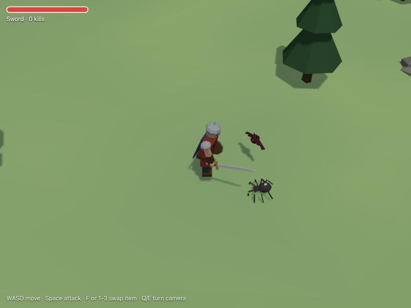
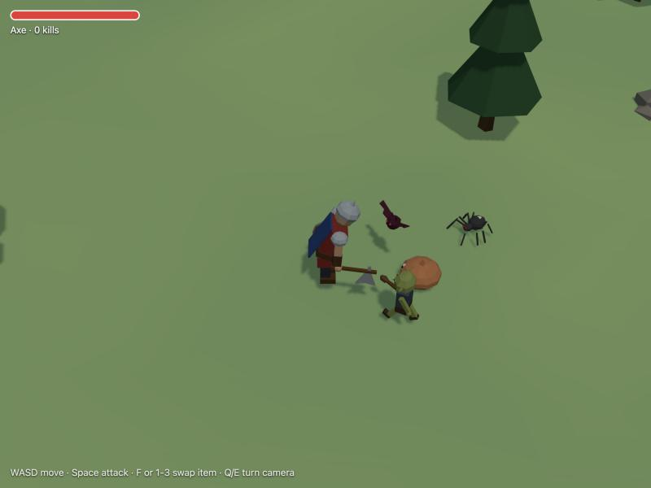
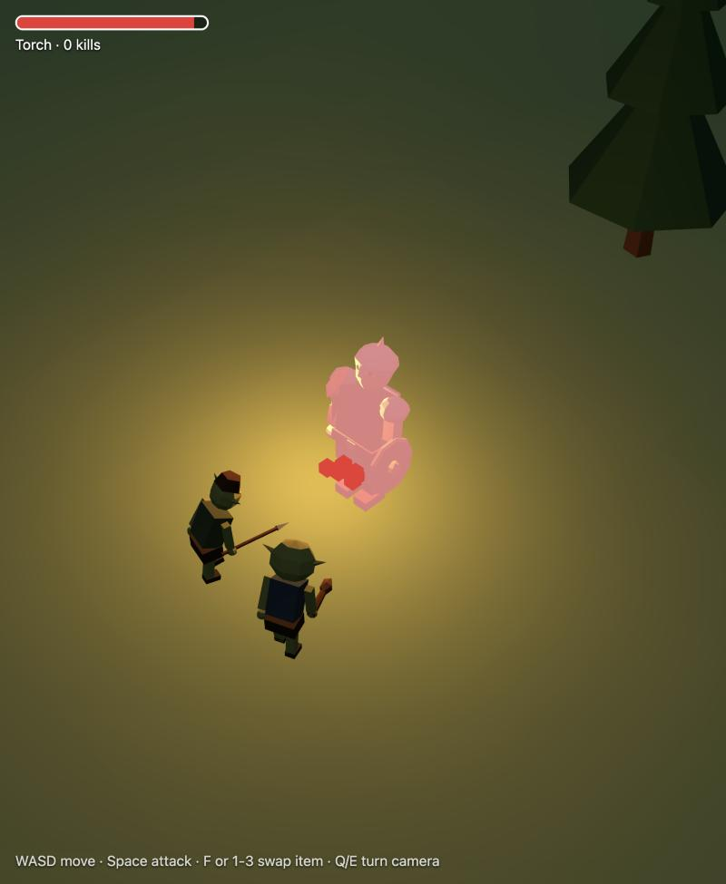
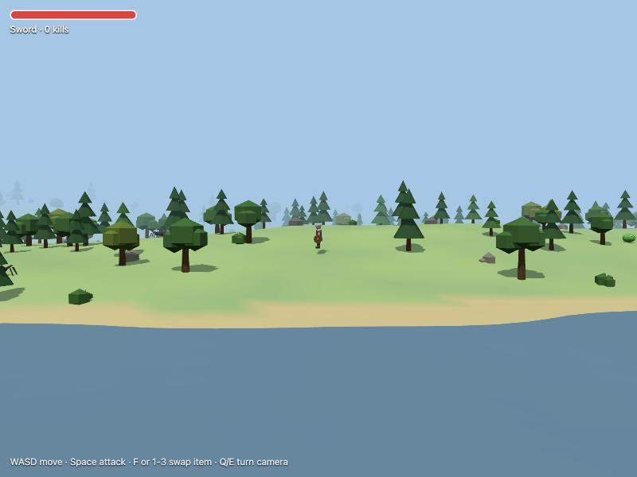
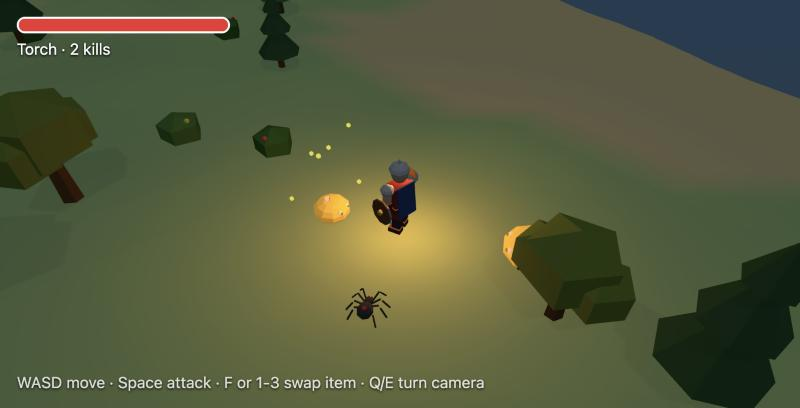
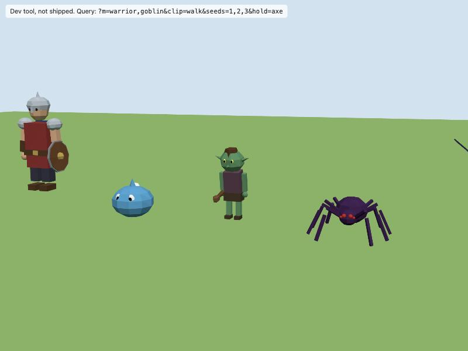

# Warrior: a 3D js13k spike measured with surprisal

A small third-person action game: a warrior runs around a seeded open world fighting slimes, goblins, spiders and bats
with a sword, an axe or a torch. Every model in it (the warrior, the props, the creatures, the trees) is **text**, and
the compiler that turns that text into rigged three.js meshes ships in the same page. The question behind it: if js13k
measured entries with [surprisal](https://github.com/benallfree/surprisal) (a language-model compressor) instead of
zip, what does a "language + JIT" architecture buy you?

```bash
npm install && npm start
```

Then open http://127.0.0.1:8713. (`npm start` builds `dist/index.html` and serves it; three.js comes from a CDN, so you
need a network connection.)

**Controls:** WASD or arrows move · Space or J attack · F, Tab or 1-3 swap the item in hand · Q/E turn the camera.
On a touch screen: drag anywhere to move, plus HIT and SWAP buttons.

| | |
|---|---|
|  |  |
|  |  |
|  |  |
|  | |

## Results in one paragraph

The whole game, readable and unminified, is about 33 KB in one HTML file. Surprisal at level 1 packs it to about 3 KB
(32,727 → 3,033 bytes, 90.7%), under a quarter of the 13,312-byte budget. The model text on its own (5,140 bytes for
the characters and props) packs to 916 bytes. So the budget is not the constraint here: by the working rule of thumb
of **~90% under surprisal**, this architecture leaves room for roughly four times as much game. I stopped measuring
after those spot checks and used that ratio while building; the full table below is a tool you can run, not
something I ran to completion.

## Architecture

```
src/models.txt   all models, skeletons and animation clips, as text (~5.8 KB)
src/dsl.js       the compiler + rig runtime: text -> three.js bones, merged meshes, clips (~9 KB)
src/game.js      world, actors, combat, AI, camera, input, HUD (~17 KB)
src/index.html   page shell: HUD markup, import map for three.js
tools/build.mjs  inlines everything into one file: dist/index.html (the shipped artifact)
tools/size.mjs   the size report (below)
tools/viewer.html  dev-only model viewer: /tools/viewer.html?m=goblin&seeds=1,2,3&clip=walk
```

The game is **one HTML file**. The build inlines `models.txt` as a `<script type="text/plain">` block and concatenates
`dsl.js` and `game.js` into one module script. At load time the page reads the model text, compiles what it needs, and
starts. There is no binary asset anywhere: no textures, no meshes, no audio files (sounds are synthesized oscillator
blips).

**three.js** is r170 (`three@0.170.0`), loaded from jsDelivr through a pinned import map. It does not count toward the
budget. The game leans on it heavily on purpose: `BoxGeometry`, `SphereGeometry`, `CylinderGeometry`,
`LatheGeometry` and `ExtrudeGeometry` are the language's primitives, so the compiler is mostly a parser and a
transform stack. `npm install` only pulls three.js so Node can run the same compiler for the size report.

## The model language

Prior art I weighed:

- **OpenSCAD-style CSG** (primitives, transforms, boolean ops): very compact, but real booleans need a mesh CSG
  library, which is a lot of code to ship. Low-poly characters don't need booleans; overlapping solids look the same.
- **SDF / implicit modeling** (Inigo Quilez style, demoscene raymarchers): the most compact text of all, and smooth
  blends look great, but you then need marching cubes or a raymarcher, it's slow to mesh at load time, and rigging an
  SDF means re-meshing per bone.
- **Demoscene mesh generators** (operator stacks like .kkrieger's): powerful, but the operator graphs are binary or
  near-binary, which is exactly what doesn't compress under surprisal.
- **Voxels**: trivially simple to interpret, but voxel models are grids of data, closer to binary than to language.

I picked **primitives with transforms, mirroring, bones and a few generative tricks**: the cheapest to interpret
(three.js does the geometry), naturally skeletal (every part names the bone it rides on), and it reads like code, which
is what a coder language model predicts best. Each line is one statement:

```text
=warrior                                   # a model block
$ cloth 9b2f2f                             # a variable (number, expression, color, or name)
b arm* chest .3 .52 0                      # bone "arm*" on parent chest at (x y z): * = mirrored pair armL/armR
b hand* arm* 0 -.55 .02 / -25 0 0          # optional rest rotation after "/", degrees
box chest cloth 0 .27 0 .46 .55 .28        # shape bone color  x y z  size...
ball8 head steel 0 .25 0 .2 .15 .2         # trailing digits = segment count
ball* head 222 .065 .19 .14 .025 .03 .02   # * on a shape = also add its mirror image (two eyes, one line)
hold handL shield                          # attach another model to a bone (a socket)
@walk .7                                   # a looping clip, .7 s per cycle
leg^ rx 35 -35                             # bone channel keys...: ^ = mirrored pair, half a cycle apart
@!swing .45                                # a one-shot clip
armR rx 0 -170 -40 0
```

| statement | meaning |
|---|---|
| `=name` | start a model block. `=common` holds clips every model inherits unless it defines its own. |
| `$ n v` | variable. `v` may be a number, `a~b` (seeded random in [a, b]), an expression (`.3*s`), a color, or `a\|b\|c` (seeded pick). |
| `b name parent x y z [/ rx ry rz]` | a bone. `name*` makes a mirrored L/R pair (L at +x, R at −x, rotations mirrored); a `parent*` resolves per side. |
| `box ball cyl lathe ext` | shapes: box `w h d`; ball (ellipsoid) `rx ry rz`; cyl `rTop h rBottom` (a cone when rTop is 0); lathe `r y r y ...`; ext `depth x y x y ...` (an extruded polygon). Optional `/ rx ry rz`, optional segment count suffix, optional `*` mirror. |
| color | 3- or 6-digit hex, a variable, or a `\|` pick. A trailing `!` makes it glow (the torch flame). |
| `S s` | scale the whole model. |
| `hold bone model` | attach a prop model to a bone. `club\|spear` picks one per seed. |
| `?p line` | keep the line with probability `p` (optional parts). |
| `* n i` | repeat the next line `n` times with `i` = 0..n−1; `{expr}` in a line is evaluated, so names like `leg{i}*` work. |
| `@name dur` / `@!name dur` | start a looping / one-shot clip. Following lines are channels until the next statement. |
| `bone ch k k k...` | a clip channel. `ch` is `rx ry rz` (degrees), `x y z` (offset), `s` or `sx sy sz` (scale offset). Keys are evenly spaced and smoothstep-interpolated; loops wrap. `bone*` mirrors, `bone^` mirrors half a cycle out of phase (walk cycles). |

Numbers anywhere can be expressions over variables, so a goblin's ears follow its random head size
(`cyl4* head k .24*h .25 0 0 .3 .07 / 0 0 -70`). Variables also carry gameplay data: a prop's `$ dmg 6`,
`$ reach 2.3`, `$ push 12`, `$ anim chop` are read by the game when you equip it, so an item is entirely defined by its
text block.

## Compiler and rig

`make(lib, name, seed)` in [src/dsl.js](src/dsl.js) runs a model's lines in order with a seeded random generator:

1. Bones become `Object3D`s in a hierarchy under the model's root; their rest transforms are recorded.
2. Each shape becomes a three.js geometry, rotated and translated into its bone's space, stripped to positions, and
   given per-vertex colors (with a little per-face shade jitter for the faceted look). Mirrored copies flip x and
   reverse the triangle winding.
3. All parts on one bone merge into **one mesh per bone**, sharing one flat-shaded Lambert material per model
   instance (so a monster can flash red without affecting others).
4. `hold` builds the prop model and parents it to the bone.

There's no skinning: parts are rigid on their bones, the classic low-poly look, and it means no weights to store.
`pose(model, layers)` resets every bone to rest and adds each clip layer's channels on top, weighted. The game blends
`idle` and `walk` by speed and lays a one-shot (`swing`, `chop`, `jab`, `attack`, `hit`, `death`) over them. Held
props run their own `idle` clip, which is how the torch flame flickers. Static models (trees, rocks, bushes) are baked
to one geometry per seeded variant and drawn with `InstancedMesh`: 16 variants, 1,450 instances.

**Props and sockets.** A socket is just a bone. The warrior's `hand*` bones carry a shield on the left (`hold handL
shield` in the warrior's own text) and whatever the player equips on the right; swapping calls `hold()` again, which
detaches the old prop and compiles the new one. Goblins use the same mechanism to carry a club or a spear. A prop's
origin sits in the fist, and each prop orients itself in its own text with a rotated root bone (`b g root 0 -.03 0 /
-10 0 0` tips the sword's blade up and forward, the axe pitches its haft down so the edge leads the chop); the swing
clip also snaps the wrist (`handR rx`) so the blade comes down level at the end of the cut.

**Deterministic creatures.** The slime, goblin, spider and bat blocks use `~` ranges, `|` picks, `?` optional parts
and `S` scale, so every seed is a different, repeatable creature: size, color, head size, horns, hats, markings,
weapons. Monster stats scale with the compiled size. The world itself is seeded too (value-noise terrain, rising at the
rim to fence the map, sand by the water, rock on the heights).



## The game

Third-person, high three-quarter perspective camera that trails the player (Q/E rotate it). A 260×260 seeded world
with water, ~1,450 trees, rocks and bushes, and a 3-minute day/night cycle (the torch earns its place at night). Sixteen
monsters at a time wander, chase within 12 units, wind up and strike; you get knocked back and flash, they get knocked
back, flash, and burst into little cubes. The sword is quick, the axe is slow and heavy with big knockback, the torch
does little damage but sets monsters alight; burning monsters flee and take damage over time. Dead monsters shrink away
and respawn somewhere around you; you regenerate slowly, and if you fall you get back up at the start.

## Size

`npm run size` builds the game and prints this table (also written to `dist/size/SIZES.md`). It needs a surprisal
build with the `-0..-9` CLI, newer than the Homebrew `0.0.1-alpha.1`; point `SURPRISAL` at it if `surprisal` on your
`PATH` is older. Results are cached by content hash in `.cache/`, because the language model is slow on large inputs.

```bash
SURPRISAL=/path/to/surprisal npm run size
```

What the report covers:

- **The shipped game** (`dist/index.html`): raw, gzip -9, zip -9 (Deflate) and Zopfli zip (the formats js13k accepts
  today), Brotli, and surprisal at each level in `LEVELS` (default `1,9`), each against 13,312 bytes.
- **Inside the build**: model text, compiler, game code and page shell, each compressed on its own.
- **Model text vs. mesh exports** of the same eleven characters and props (one seeded variant each, bones and clips
  included in every format): the DSL text, the same content rewritten as JavaScript calls, a JSON mesh export, a
  float32 non-indexed binary (what the compiler hands the GPU), and a quantized, indexed int16 binary.

Spot checks taken during development (surprisal level 1, 0.5B model):

| input | raw | surprisal -1 | saved |
|---|---:|---:|---:|
| `dist/index.html`, the whole game | 32,727 | 3,033 | 90.7% |
| model text for the 11 characters and props | 5,140 | 916 | 82.2% |

The full run is slow on the mesh exports: the JSON export alone is 270 KB, and surprisal at level 1 manages roughly
400 bytes of text a second on this Mac, slower on binary. Expect the whole report to take the better part of an
hour the first time; the cache makes reruns cheap.

## What fit, what didn't, and what I learned

- **Everything fit, with lots of room.** At ~3 KB under surprisal, the game uses under a quarter of the budget. Under
  plain gzip -9 the same readable source is 12,460 bytes, which squeaks under today's limit with ~850 bytes to
  spare and no room to grow without minifying. The real difference is that under surprisal you never minify, mangle or Roadroller anything: readable
  source with real names *is* the compact form.
- **Text models are cheap, and get cheaper with structure.** Eleven rigged, animated models (the warrior, six props,
  four creature generators) are 5.1 KB of text and under 1 KB compressed. The compiled meshes they produce are about
  10,500 vertices; even a quantized binary export of one variant each is tens of kilobytes before compression, and
  binary is exactly what a language model can't predict. The text also isn't one variant: each creature block is a
  generator, so the game gets unlimited seeded variants (and four tree/rock/bush variants each) from the same bytes.
- **The compiler costs about as much as the models.** `dsl.js` is ~9 KB raw, but it's ordinary JavaScript that the
  model predicts well, and it's a fixed cost: every extra model is a few hundred bytes of text.
- **Leaning on three.js is what makes the JIT small.** Primitive geometries, lathe, extrude, merging and instancing
  all come free, so the "compiler" is a ~250-line parser and transform stack.
- **Rigid parts on bones beat skinning here.** No weights to store, mirroring halves most models, and animation is a
  few keyframes per channel. The look is consistent with the low-poly style.
- **What I left out:** CSG and SDF modeling (too much code or too slow to mesh at load time), skinned meshes, a real
  audio track, textures, and a bigger enemy roster or quests. Given the headroom, more content (bosses, a village,
  more items, a music sequencer written as text) is the obvious next step, not further squeezing.
- **Dev notes:** `/tools/viewer.html` (dev only, not shipped) shows any model, seed, clip or held item, e.g.
  `?m=goblin&seeds=1,2,3&clip=walk`. The page exposes `window.game` for play-testing from the console.
