# Wellfire post-mortem: the development journal

> **This is the development history, not the manual.** It is the project's old README, kept nearly as it was: each
> section was written as that feature was built, with its design notes and costs. For the game as it is now, read the
> [README](../README.md).
>
> - **Numbers are as measured at the time.** File sizes, byte counts, "+N KB raw" costs and surprisal results describe
>   the build of that day; the game has since grown several times over. The early "about 3 KB under surprisal" result
>   in particular is long out of date (current figures are in the README).
> - **Some mechanics are superseded**, and later sections often say so themselves. The fixed high three-quarter camera
>   became the chase camera; Q/E strafing, mouse drag-to-turn, the T torch key and B boat key are gone; the
>   over-the-shoulder alt camera became first person (C, and always in caves); thunder eggs gave way to rocks and caves;
>   the 4-slot tray grew to 8. Screenshots show the HUD and help line of the build they were taken on.
> - Related write-ups: [JSON vs. the text DSL](json-vs-dsl.md), [refactor size](refactor-size.md),
>   [goal ideas](goal-ideas.md), [world layers](world-layers.md).

---

# Warrior: a 3D js13k spike measured with surprisal

**Play Wellfire:** https://benallfree.github.io/wellfire/ (built from `main` on every push by `.github/workflows/pages.yml`)

A small third-person action game: a warrior runs around a seeded open world fighting slimes, goblins, spiders and bats
with a sword, an axe or a torch. Every model in it (the warrior, the props, the creatures, the trees) is **text** (plain
JSON), and the compiler that turns it into rigged three.js meshes ships in the same page. The question behind it: if js13k
measured entries with [surprisal](https://github.com/benallfree/surprisal) (a language-model compressor) instead of
zip, what does a "language + JIT" architecture buy you?

```bash
npm install && npm start
```

Then open http://127.0.0.1:8713. (`npm start` builds `dist/index.html` and serves it; three.js comes from a CDN, so you
need a network connection.)

**Controls:** W/S or up/down walk forward and back · A/D or left/right turn ·
Space or J uses what's in hand: a weapon attacks (the axe also chops trees and breaks flint), a potion is drunk, the
whistle calls the roc, and wood, flint and a boat are thrown · F or Tab swap the item in hand · 1-8 pick a tray
slot (7 potion, 8 whistle), 0 crafting · the torch is a weapon: taking it in hand lights it (a burnt-out one is used up), and Space
at a well sets a torch and a sunstone in the beacon, then aims the beam (turn, W/S tilt; R lets go) · wood, flint, a potion and the whistle are held up over his head in both hands (shield and
weapon put away on his back; Space throws one, and the last one thrown puts the weapon back in hand) · a boat (slot 6) is
carried the same way, upside down, and Space throws it where it should float · R ride, board and leave the boat,
or let go of a beam · C switches between the chase camera and first person (in first person A/D strafe; click to lock the pointer, then the mouse or trackpad looks around in every direction and a click attacks; Esc lets go; caves are always first person) · M or the ♪ button toggles sound.
On a touch screen: drag anywhere (up/down walks, sideways turns), plus HIT, SWAP and RIDE buttons, and tap a tray slot. See
[Chase camera](#chase-camera).

| | |
|---|---|
| 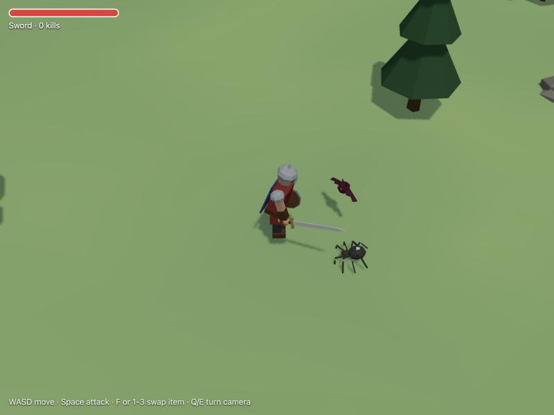 | 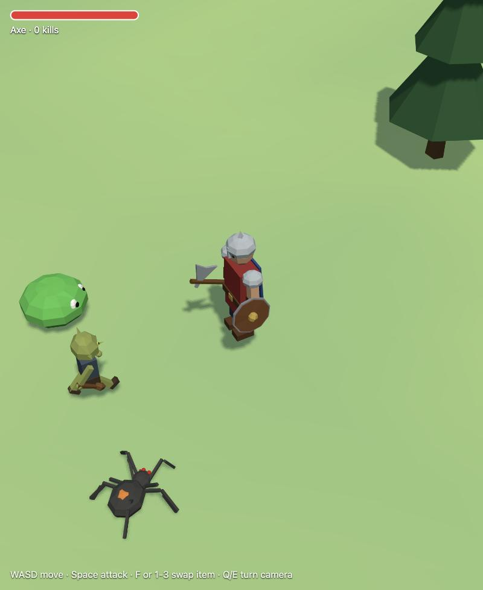 |
| 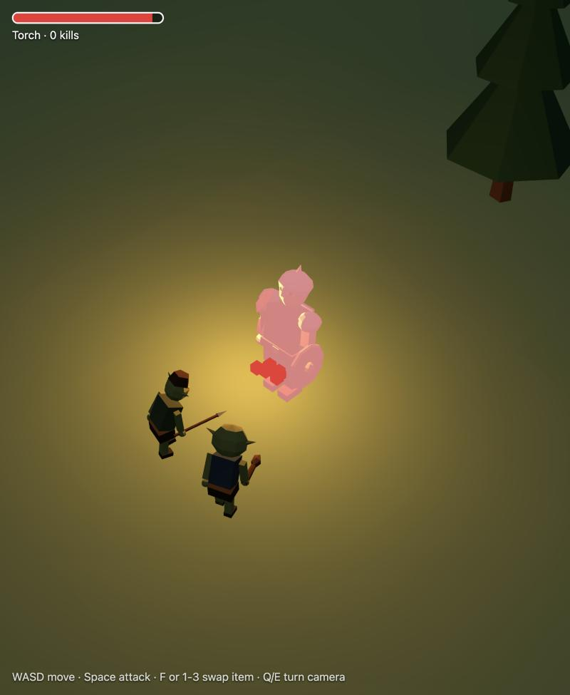 | 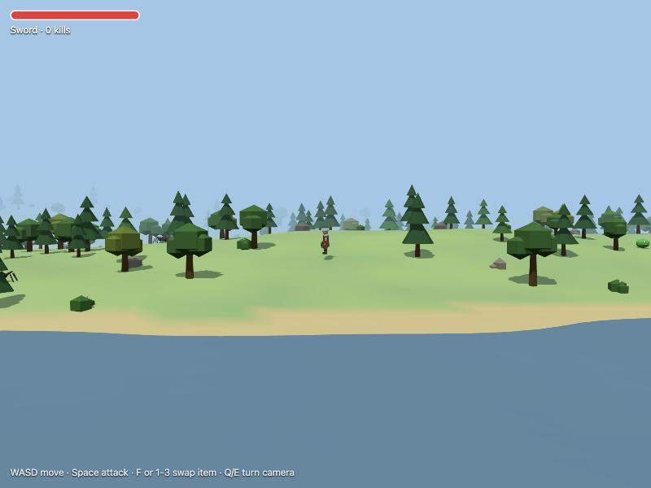 |
| 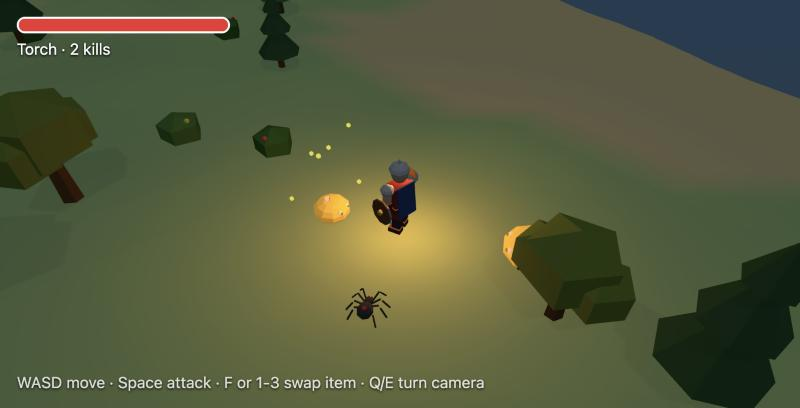 | 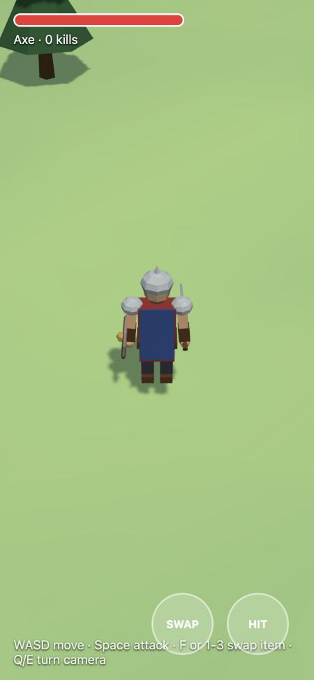 |
| 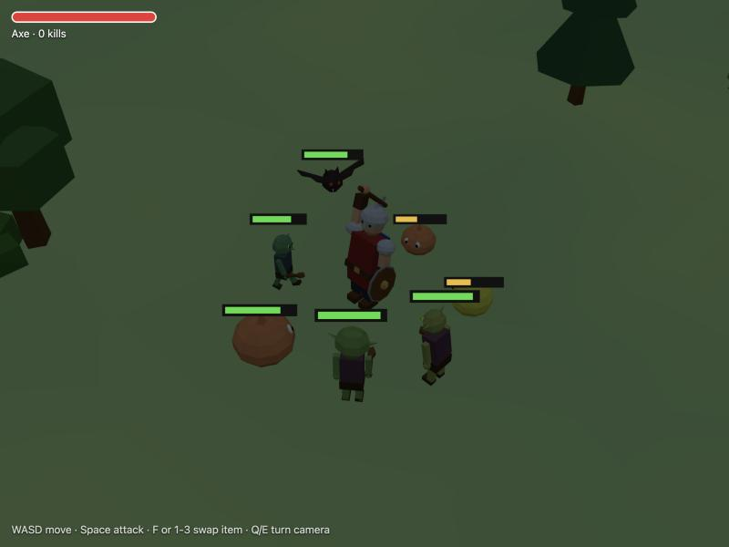 | |

## Results in one paragraph (superseded: an early measurement)

The whole game, readable and unminified, is about 33 KB in one HTML file. Surprisal at level 1 packs it to about 3 KB
(32,727 → 3,033 bytes, 90.7%), under a quarter of the 13,312-byte budget. The model text on its own (5,140 bytes for
the characters and props) packs to 916 bytes. So the budget is not the constraint here: by the working rule of thumb
of **~90% under surprisal**, this architecture leaves room for roughly four times as much game. I stopped measuring
after those spot checks and used that ratio while building; the full table below is a tool you can run, not
something I ran to completion. (Those numbers predate the switch from the text DSL to JSON models, which made the
compiler + models bundle 170 bytes smaller under surprisal: see [docs/json-vs-dsl.md](json-vs-dsl.md).)

## Architecture

```
src/models.json  all models, skeletons and animation clips, as pretty-printed JSON (~86 KB raw)
src/compiler.js  the compiler + rig runtime: JSON -> three.js bones, merged meshes, clips (~8.4 KB)
src/score.json   the music: voices and sections as pretty-printed JSON, note patterns as strings (~3.8 KB)
src/music.js     the score compiler, synthesized instruments + WebAudio sequencer (~16 KB)
src/game.js      world, actors, combat, AI, camera, input, HUD (~17 KB)
src/index.html   page shell: HUD markup, import map for three.js
tools/build.mjs  inlines everything into one file: dist/index.html (the shipped artifact)
tools/ship.mjs   build + baseline + surprisal -3 --compare: dist/index.13k vs. the baseline and the budget (below)
tools/roadroll.mjs  the js13k baseline: terser -> roadroller -> advzip, dist/roadroller/index.zip (below)
tools/size.mjs   the size report (below)
tools/formats.mjs  JSON vs. the old text DSL and other formats under surprisal (docs/json-vs-dsl.md)
tools/viewer.html  dev-only model viewer: /tools/viewer.html?m=goblin&seeds=1,2,3&clip=walk
tools/warrior.mjs  dev-only: writes the warrior's bones and clips into models.json (leg IK, stance baked into the rest pose)
```

The game is **one HTML file**. The build inlines `models.json` as a `<script type="application/json">` block and `score.json`
the same way, and concatenates `compiler.js`, `music.js` and `game.js` into one module script. At load time the page parses the models, compiles what it needs, and
starts. There is no binary asset anywhere: no textures, no meshes, no audio files (the music is compiled from
`score.json` and synthesized with WebAudio; effects are oscillator blips).

**three.js** is r170 (`three@0.170.0`), loaded from jsDelivr through a pinned import map. It does not count toward the
budget. The game leans on it heavily on purpose: `BoxGeometry`, `SphereGeometry`, `CylinderGeometry`,
`LatheGeometry` and `ExtrudeGeometry` are the format's primitives, so the compiler is mostly a transform stack. `npm install` only pulls three.js so Node can run the same compiler for the size report.

## The model format

> The models were first written in a custom line-based DSL (`box chest cloth 0 .27 0 .46 .55 .28`). Measuring showed
> that the same content as plain pretty-printed JSON packs about 10% smaller under surprisal, and the whole
> compiler + models bundle smaller too, even though the JSON is seven times bigger raw. So the game now ships JSON. The
> comparison, and the old DSL with its compiler, are in [docs/json-vs-dsl.md](json-vs-dsl.md) and `tools/formats/`.

Prior art I weighed:

- **OpenSCAD-style CSG** (primitives, transforms, boolean ops): very compact, but real booleans need a mesh CSG
  library, which is a lot of code to ship. Low-poly characters don't need booleans; overlapping solids look the same.
- **SDF / implicit modeling** (Inigo Quilez style, demoscene raymarchers): the most compact text of all, and smooth
  blends look great, but you then need marching cubes or a raymarcher, it's slow to mesh at load time, and rigging an
  SDF means re-meshing per bone.
- **Demoscene mesh generators** (operator stacks like .kkrieger's): powerful, but the operator graphs are binary or
  near-binary, which is exactly what doesn't compress under surprisal.
- **Voxels**: trivially simple to interpret, but voxel models are grids of data, closer to binary than to language.

I picked **primitives with transforms, mirroring, bones and a few generative tricks**: the cheapest to interpret
(three.js does the geometry), naturally skeletal (every part names the bone it rides on), and written in a form a
language model predicts well. `src/models.json` maps each model name to a block like this (shortened; the file is
`JSON.stringify(models, null, 2)`, which puts every array element on its own line):

```json
"warrior": {
  "vars": { "cloth": "9b2f2f", "steel": "bcc6d0" },
  "bones": [
    { "name": "shin*", "parent": "leg*", "position": [0, -0.45, 0], "rotation": [49, 0, 0] },
    { "name": "handR", "parent": "foreR", "position": [0, -0.27, 0.02], "rotation": [50, 0, 0] }
  ],
  "parts": [
    { "shape": "box", "bone": "chest", "color": "cloth", "position": [0, 0.27, 0], "size": [0.46, 0.55, 0.28] },
    { "shape": "ball", "bone": "head", "color": "steel", "position": [0, 0.25, 0], "size": [0.2, 0.15, 0.2], "segments": 8 },
    { "shape": "ball", "bone": "head", "color": "222", "position": [0.065, 0.19, 0.14], "size": [0.025, 0.03, 0.02], "mirror": true }
  ],
  "holds": [{ "bone": "handL", "model": "shield" }],
  "clips": {
    "walk": { "duration": 0.7, "loop": true, "channels": [{ "bone": "leg^", "channel": "rx", "keys": [35, -35] }] },
    "swing": { "duration": 0.45, "loop": false, "channels": [{ "bone": "armR", "channel": "rx", "keys": [0, -170, -40, 0] }] }
  }
}
```

| field | meaning |
|---|---|
| model name | a top-level key. `common` holds clips every model inherits unless it defines its own. |
| `vars` | variables. A value may be a number, `"a~b"` (seeded random in [a, b]), an expression (`".3*s"`), a color, a name, or `"a\|b\|c"` (seeded pick). |
| `scale` | scale the whole model (number or expression). |
| `bones[]` | `name`, `parent`, `position`, optional `rotation` (degrees). A name ending in `*` makes a mirrored L/R pair (L at +x, R at −x, rotations mirrored); a `parent*` resolves per side. |
| `parts[]` | `shape`, `bone`, `color`, `position`, `size`, optional `rotation`, `segments`, `mirror`. Shapes: `box` size `w h d`; `ball` (ellipsoid) `rx ry rz`; `cyl` `rTop h rBottom` (a cone when rTop is 0); `lathe` `r y r y ...`; `ext` `depth x y x y ...` (an extruded polygon). `mirror: true` also adds the part's mirror image (two eyes, one entry). |
| color | 3- or 6-digit hex string, a variable, or a `\|` pick. A trailing `!` makes it self-lit: it shows its own colour even in the dark (flames, eyes, windows). |
| `holds[]` | `bone`, `model`: attach a prop model to a bone (a socket). `"club\|spear"` picks one per seed. |
| `chance` | on any bone, part, hold or channel: keep it with that probability (optional parts). |
| `repeat`, `var` | on any bone, part, hold or channel: repeat it `repeat` times with `var` = 0..n−1. `"{expr}"` inside a string is evaluated, so names like `"leg{i}*"` and positions like `"{.2-i*.12}"` work. |
| `clips` | `name: { duration, loop, channels }`. A channel is `bone`, `channel` (`rx ry rz` degrees, `x y z` offset, `s` or `sx sy sz` scale offset) and `keys`, evenly spaced and smoothstep-interpolated; loops wrap. `bone*` mirrors, `bone^` mirrors half a cycle out of phase (walk cycles). |

Numbers anywhere can be expressions over variables (strings), so a goblin's ears follow its random head size
(`"position": [".24*h", 0.25, 0]`). Variables also carry gameplay data: a prop's `"dmg": 6`, `"reach": 2.3`,
`"push": 12`, `"anim": "chop"` are read by the game when you equip it, so an item is entirely defined by its block.

## Compiler and rig

`make(lib, name, seed)` in [src/compiler.js](../src/compiler.js) walks a model's block in order (vars, bones, parts, holds, clips) with a seeded random generator:

1. Bones become `Object3D`s in a hierarchy under the model's root; their rest transforms are recorded.
2. Each shape becomes a three.js geometry, rotated and translated into its bone's space, stripped to positions, and
   given per-vertex colors (with a little per-face shade jitter for the faceted look). Mirrored copies flip x and
   reverse the triangle winding.
3. All parts on one bone merge into **one mesh per bone**, sharing one flat-shaded Lambert material per model
   instance (so a monster can flash red without affecting others).
4. `hold` builds the prop model and parents it to the bone.

There's no skinning: parts are rigid on their bones, the classic low-poly look, and it means no weights to store.
`pose(model, layers)` resets every bone to rest and adds each clip layer's channels on top, weighted. The game blends
`idle` and `walk` by speed and lays a one-shot (`swing`, `chop`, `jab`, `attack`, `hit`, `death`) over them. Held
props run their own `idle` clip, which is how the torch flame flickers. Static models (trees, rocks, bushes) are baked
to one geometry per seeded variant and drawn with `InstancedMesh`: 16 variants, refilled as world chunks come and go.

**Props and sockets.** A socket is just a bone. The warrior's `hand*` bones carry a shield on the left (`hold handL
shield` in the warrior's own block) and whatever the player equips on the right; swapping calls `hold()` again, which
detaches the old prop and compiles the new one. Goblins use the same mechanism to carry a club or a spear. A prop's
origin sits in the fist, and each prop orients itself in its own block with a rotated root bone (the sword's bone `g`
on `root` with rotation `[-10, 0, 0]` tips the blade up and forward; the axe pitches its haft down so the edge leads
the chop); the swing clip also snaps the wrist (a `handR` `rx` channel) so the blade comes down level at the end of
the cut.

**The warrior's rig.** He has three joints per limb: `arm*` (shoulder) → `fore*` (elbow) → `hand*` (wrist, the prop
socket), and `leg*` (hip) → `shin*` (knee) → `foot*` (ankle), under `hip` → `chest` → `head`/`cape`. Thigh 0.45 + shin
0.42 + 0.08 from ankle to sole puts his soles on the ground (the old single-segment legs left him hovering 0.36 above
it). His **rest pose is the fighting stance**: knees bent, shield foot forward, sword arm cocked, shield up and turned
to face forward, torso turned a little. Because the two sides of a stance differ, most limbs are written as separate
`armL`/`armR` bones instead of one `arm*`. Every clip then stores only what moves away from the stance: `idle` is a
breath (chest and guard), `walk` bends the knees through the stride with a heel strike and a toe off, swings the elbows
and counter-rotates hips and shoulders, and the one-shots (`swing`, `chop`, `jab`, `hit`, `death`) are deltas laid on top
of idle/walk, winding up and following through with shoulder, elbow, wrist and torso twist while the hips drop and
shift over planted feet. He has his own `ride` (thighs forward and spread, knees bent, hips square) in place of `common`'s,
whose deltas were written for the old straight-legged rest pose.

Those bones and clips are not hand-typed: [tools/warrior.mjs](../tools/warrior.mjs) (dev only) writes them into
`models.json` from absolute poses. It solves each leg with planar two-bone IK from a hip offset and a foot target, so
the feet stay on the ground (within a few cm) while the body crouches, lunges and dips; folds L/R pairs back into `*`
and `^` channels where they mirror; keeps 4 walk keys instead of 8 where the curve allows; and drops channels that
never move more than 5° or 2 cm. The wrist angles in the attack keys were solved so the blade, haft or torch points
where the move needs it at each key. `chop` has six keys so its downswing passes through the game's hit moment (45% of
the clip). Edit the poses there and run `node tools/warrior.mjs`; edit his parts in `models.json` directly. Other
models are untouched, and `common` (hit and death on the root) still serves the monsters.

`lift` (laid over idle and walk) holds an item level over his head in both hands: arms straight up and a little in,
torso squared, the right wrist turned so the log lies across. The game hides the shield and slings the last weapon on
his back (the village stow, reused) while wood or flint is in hand.

Raw cost: the warrior's block grew from ~9.5 KB to ~29.6 KB of pretty JSON (+20.1 KB; ~3.8 → ~10.1 KB as compact JSON),
almost all of it one-shot keyframes. Not measured under surprisal.

| stance (sword, axe, torch) | walk |
|---|---|
| 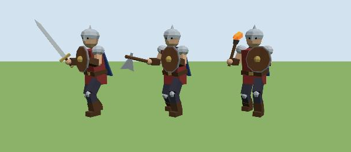 | 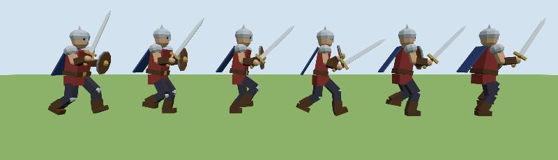 |
| **swing** | **death** |
| 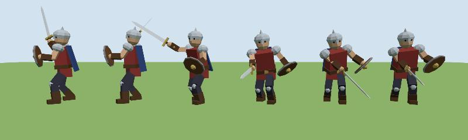 | 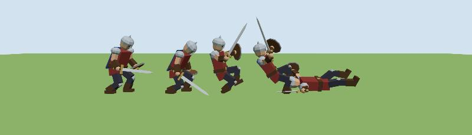 |

**Deterministic creatures.** The slime, goblin, spider and bat blocks use `~` ranges, `|` picks, `chance` optional
parts and `scale`, so every seed is a different, repeatable creature: size, color, head size, horns, hats, markings,
weapons. Monster stats scale with the compiled size. The world itself is seeded too, and endless (see
[Endless world](#endless-world)).

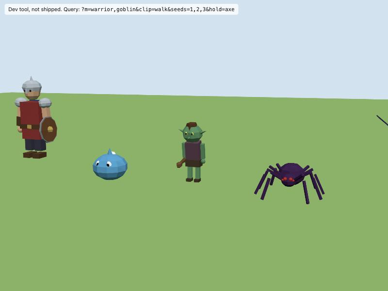

## The game

Third-person camera (at first a fixed high three-quarter view; since superseded by the chase camera and first person). An endless seeded world
of meadows, forests, rocky hills and lakes, with an exploration minimap, and a 3-minute day/night cycle (the torch earns
its place at night). Twelve to twenty-odd monsters at a time wander, chase within 12 units, wind up and strike; you get knocked back and flash, they get knocked
back, flash, and burst into little cubes. The sword is quick, the axe is slow and heavy with big knockback, the torch
does little damage but sets monsters alight; burning monsters flee and take damage over time. Steeds and drakes can be
found and ridden (see Mounts). Dead monsters shrink away
and respawn somewhere around you. Health comes back fast in a village (`townRegen`) and not at all in the wilds
(`fieldRegen` 0); out there you heal from potions and berries. About 40% of bushes carry a cluster of red berries
(`berrybush.chance`, seeded per bush, glowing faintly so they show at night): walk into one while hurt to eat it for a
tenth of your health (`heal` 0.1, 3 of 30), and it grows back after 4 minutes (`regrow` 240 s; kept in
`warriorFelled` as `"b" + index`). A full-health warrior leaves them alone. If you fall you get back up at the start.

## Music

The background music is text too: [src/score.json](../src/score.json), compiled at load by
[src/music.js](../src/music.js) and played by a small WebAudio sequencer. Up to fourteen voices sound at once (lead or bell,
arpeggio, pad chords, bass, kick, hi-hat, and a part for each kind of monster), all synthesized in code: no samples, no
audio files. See **Instruments** below for how each one is built.

Prior art I weighed: **ZzFXM** and **Soundbox** (the js13k standards) store patterns as arrays of numbers, compact for
zip but close to binary, which is what surprisal can't predict. **Tracker patterns** read well as a grid but spell out
every note. **ABC notation** is readable text but its full grammar (lengths, ties, keys, repeats) is a lot of parser.
I took the tracker's grid (one token per step, voices lined up) and ABC's note letters, and added one idea from lead
sheets: a **chord track**. Bass and arpeggio lines are written as chord tones (`1` root, `2` third, `3` fifth, `4` root an
octave up, ...), so one short line plays over any progression, and a new section only needs new chords and a melody.

The file follows the models' format choice ([docs/json-vs-dsl.md](json-vs-dsl.md)): pretty-printed JSON with
named keys, because under surprisal the keys are nearly free and tell the model what each number is. The note patterns
stay strings: a pattern is the notation itself, the tokens are letters rather than numbers, and one string per part keeps
the bars readable. (An earlier version was a line-based text format with the same patterns; the JSON compiles to
identical notes and packs smaller: 392 → 265 bytes for the score alone at surprisal -1, despite being 60% bigger raw.) Abridged:

```json
{
  "tempo": { "bpm": 104, "stepsPerBeat": 2, "beatsPerBar": 4 },
  "order": { "day": ["A", "A", "B", "A"], "night": ["N", "N", "M", "N"] },
  "voices": {
    "bass": { "wave": "bass", "octave": 2, "volume": 0.036, "attack": 0.005, "release": 0.12, "reverb": 0.1 },
    "arp": { "wave": "pluck", "octave": 4, "volume": 0.24, "attack": 0.002, "release": 1.2, "bright": 0.55, "pan": -0.35, "calm": true },
    "boing": { "wave": "marimba", "octave": 4, "volume": 0.27, "attack": 0.002, "release": 0.5, "monster": "slime" }
  },
  "allSections": { "boing": "1,4 . . 1,4 . . 3,5 ." },
  "sections": {
    "A": {
      "chords": "C G Am F",
      "parts": {
        "lead": "e . g . c6 - b . | b - g - d - . . | c . e . a - g . | a - g - f - . .",
        "bass": "1 . . 1 3 . 1 .",
        "pad": "* - - - - - - -",
        "hat": ". x . x . x . x,x"
      }
    },
    "B": { "base": "A", "chords": "F G Em Am", "parts": { "lead": "f . a . c6 - a . | ..." } }
  }
}
```

(The real file is `JSON.stringify(score, null, 2)`, so arrays and objects are expanded one item per line.)

- `tempo`: a step is one eighth note at 104 bpm; a bar is 8 steps.
- `order`: the sections played by day and after dark, looping.
- `mix`: the level of the whole music bus, set so the music sits under the game's sound effects.
- `voices`: `wave` (the instrument), `octave` (for notes without one), `volume`, `attack` and `release` in seconds
  (release is also the damper on struck and plucked notes, and how long their buffer rings), optional `filter` in Hz
  (low-pass, or high-pass on `hat`), `pan` (-1..1), `reverb` (send level, default 0.25), `chorus: true` (ensemble
  chorus), `bright` and `sustain` for `pluck` (excitation brightness 0..1, per-period loss), and either `calm: true` (ducks while monsters are near) or `monster: "<kind>"`
  (silent until that kind is near).
- `allSections`: parts that join every section (the monster parts).
- `sections`: `chords` (one chord per bar; `"C,G"` splits a bar), `parts` (voice name to pattern), and an optional
  `base` section whose parts it starts from. A pattern shorter than the section repeats.

Pattern tokens, separated by spaces:

| token | meaning |
|---|---|
| `c` `f#` `bb` `a4` | a note; the digit is the octave, otherwise the voice's octave |
| `1`..`9` | a tone of the current chord, counted up from the root in the voice's octave |
| `*` | the whole current chord |
| `x` `o` | a drum hit, `o` louder (any token hits on a `noise` or `kick` voice) |
| `-` | hold the previous note one more step |
| `.` | rest |
| `a,b` | split one step (or one bar, on the chord line) evenly between tokens |
| `\|` | bar line, ignored |

Waves are the instruments below, or any oscillator type (`sine`, `square`, `sawtooth`, `triangle`) with a plain
envelope. Drums are `kick`, `taiko`, `snare` and `hat`. Chords are a root, optional `#`/`b`, optional `m`, optional `7`.

**Instruments.** The first version played raw oscillators with on/off envelopes (full level until the note ended), no
filter movement, no variation between notes, dry and in mono, which is what made it sound like a chip tune. Each
instrument is now a small synthesis recipe, picked for what makes that instrument recognisable:

| wave | used by | how |
|---|---|---|
| `flute` | lead (day melody), flutter (bat) | a sine-ish wave (a few soft harmonics) with a breath-noise chiff on the attack and vibrato that fades in only on held notes |
| `pluck` | arp (harp), crawl (spider pizzicato) | Karplus-Strong: a noise burst circulating in a one-period delay line that is averaged every pass, with fractional-delay tuning so high notes stay in tune |
| `bell` | bell (night melody) | inharmonic partials (1, 2, 3.01, 4.17, 5.43) with the high ones dying first, plus a beating copy of the fundamental; each partial is a two-pole resonator so a pitch renders in a few ms |
| `strings` | pad | three detuned saws per note, a low-pass that opens over the slow attack, and a shared ensemble chorus (two LFO-swept delays panned apart) |
| `brass` | riff (goblin) | two saws that scoop up into pitch, through a low-pass that blares open on the attack and settles |
| `bass` | bass | a saw plus a sine under a filter that snaps shut: a round, plucked bass |
| `marimba` | boing (slime) | a mallet sine whose pitch drops into place, plus a fast-dying fourth partial |
| `taiko` / `kick` | kick (frame drum), wardrum (goblin) | a pitch-swept sine with a noise click (kick) or a dark skin-noise layer (taiko) |
| `snare` / `hat` | snare, hat, tick | a two-mode tone body plus high-passed noise; hats are high-passed noise whose decay is the voice's release |

Struck and plucked sounds are rendered once per pitch into a cached AudioBuffer. Every pitch the score uses is
pre-rendered, one per scheduler tick, so a first note never stalls a frame. Held sounds are live oscillator graphs a few
nodes deep. Every note is humanized: up to 6 ms of timing slop, ±12% velocity with lighter off-beats, and a few cents of
pitch drift (drums ±30 cents, as hand drums vary). All voices share one convolution reverb, whose impulse is
generated noise that decays and darkens as it fades, plus a stereo pan per voice. The master chain is the night low-pass,
a 30 Hz rumble and DC cut, a gentle compressor (3:1 from -20 dB), and `mix` (0.6). The music now sits about 2 dB under
its old level, so the combat blips cut through.

Cost: `music.js` grew from 7,928 to 16,489 bytes raw (+8.6 KB) and the score's voice settings from 3,759 to 4,170
(+0.4 KB). At the ~90% the project assumes for surprisal, that is roughly +0.9 KB shipped. At runtime a scheduler tick
averages under 1 ms (about 0.1 ms once the buffers are warm), measured in Chrome with every monster part playing. Before
and after renders of each section, made with an OfflineAudioContext (12 s each, AAC), are in
[docs/audio/](audio/): `A-before.m4a` / `A-after.m4a` and the same for `B`, `N` (night), `M`, and `monsters` (section
A with every monster part in).

**Compiler and player.** `score()` parses the JSON and compiles every section into per-step event lists with notes
already resolved to frequencies and lengths, so the runtime never parses. `sequencer()` is the classic lookahead
scheduler: every 50 ms it schedules the steps that start in the next 250 ms on the audio clock, so timing stays
sample-accurate and sections loop without a seam. The same function renders into an `OfflineAudioContext`, which is how
I checked levels and seams without listening.

**It follows the game.** When the light drops, the player switches to the night order at the next bar line (the same
bar of the new section) and a master low-pass filter darkens the mix. The tempo never changes: the music reacts by
changing which parts play, not how fast.

**Every monster kind has its own part.** A voice tagged with a monster kind fades in while
one of that kind is within 14 units and fades out (more slowly) once none is, so you can hear what's coming before you
see it, and a mixed pack stacks its parts:

| monster | part |
|---|---|
| slime | `boing`: bouncing marimba octave leaps |
| goblin | `wardrum`, `snare`, `riff`: a marching war-drum beat under a low brass riff |
| spider | `crawl`, `tick`: a skittering 16th-note pizzicato arpeggio over clicking legs |
| bat | `flutter`: a high flute trill |

The parts are written in chord tones, so they fit every day and night section. Voices tagged `calm` (the arpeggio) duck
out while any monster is near. The parts sit in the mid and high range on purpose: a first version used one shared
fight layer that was mostly bass, which laptop speakers barely play, so it went unheard. Audio starts on the first key, click or touch (browsers require a gesture); muting suspends the AudioContext, so the scheduler pauses too,
and the choice is remembered. The music module, score and hooks add 12,985 bytes raw to the build and **1,044 bytes at
surprisal -1** (the whole game goes from 3,068 to 4,112 bytes). With the old text score the music cost 1,204.

## Villages

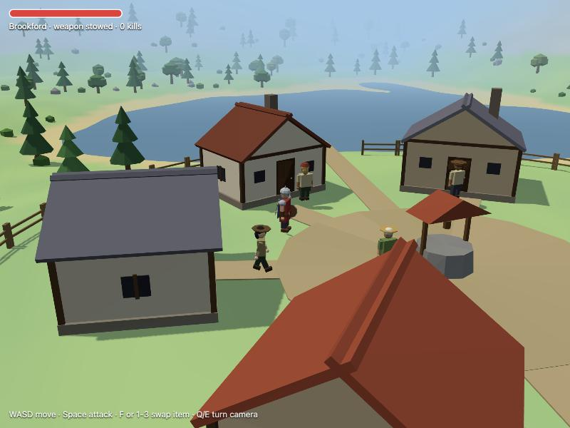

Villages are part of the seeded world (see [Villages and roads](#villages-and-roads-in-the-seeded-world) below): one
always sits about 30 units from the start, and more turn up every few hundred units, joined by roads. Each has five
to eight houses round a square with a well, dirt paths to each door, and a fence ring with a gate wherever a road
leaves. Townspeople stroll between the doors and the well and stop to idle. Walk
in and the warrior hangs the weapon on his back (each item is aimed by its own shape: its longest end points down,
a torch's flame up); attacking is disabled and the HUD shows the village's name. Walk out
and the weapon is back in hand. Monsters don't spawn inside, stop chasing once you're in, and are pushed back at the
fence, so they wait at the edge. Walk into any door: the screen fades to black and you're inside, by the fire. Walk
back out of the door and you're outside again, in front of it.

| weapon stowed | inside a house |
|---|---|
| 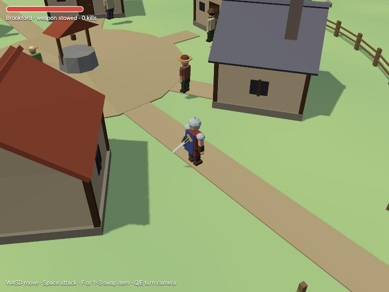 | 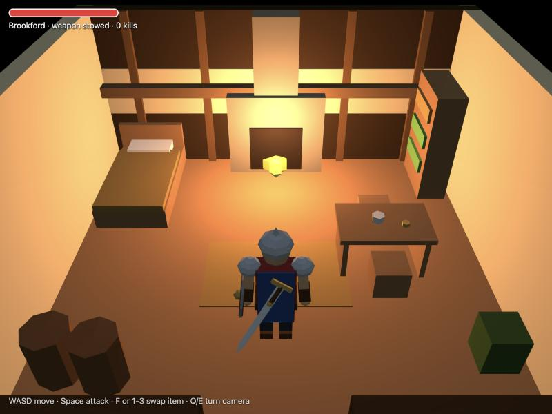 |

How other games do this cheaply, and what I picked:

- **Zones.** MMO sanctuaries and towns are just a radius check. Monsters "leash": they give up the chase at the
  boundary. Here the village is a circle: inside it you stow the weapon, monsters drop the chase, and a collider keeps
  them outside the fence.
- **Interiors.** The usual options are a streamed separate map behind a load door (Zelda, Pokémon, Skyrim), a roof
  that lifts off when you step in (Ultima VII, Fallout 1/2), or a cutaway room with the near walls cut low (The Sims,
  Diablo). I picked a **door warp with a fade to black, into a cutaway room**. Each room is built under its house, 40
  units and more below the ground, where the terrain hides it. The same scene, renderer and `Actor` movement apply,
  with no scene swap and no streaming. The fade hides the jump. Inside, a fixed camera looks in over a low front wall,
  so no wall-occlusion code is needed, and the sky turns black, the sun goes off and the hearth's light comes up.
  A roof lift-off would need real interiors inside every house shell and a camera that copes with walls.
- **Houses in the way.** Outside, a house between the camera and the player fades see-through (Diablo-style), so the
  warrior is never lost behind a roof.

The models are JSON in `src/models.json` like everything else: `villager` (the warrior's skeleton with seeded skin, shirt, trousers, hair,
optional apron and straw hat, and seeded build), `house` (seeded width, depth, wall height, roof pitch and colours,
with gable, slanted roof, timber frame, door, windows and an optional chimney), `room` (seeded size and colours, with
bed, table and stools, hearth with a glowing fire, bookshelf, rug, and optional barrels and a crate), and `well`,
`fence`, `plaza` and `path`. The layout (where houses go, which way they face, the paths, the fence and its gates, the
name, e.g. "Brookford") is generated in `game.js` from a seed. The terrain is levelled under the village by blending
`height()` toward the site's height.

**Model format additions: none.** Solid house shells plus separate rooms meant no hollow boxes or door cutouts. A door
is a dark box on the front wall, a gable is an `ext` triangle, and the roof slopes are boxes whose angle is an
expression (`"{Math.atan2(r,w/2)*57.3}"`). The existing variables, `a~b` ranges, `|` picks and `chance` parts covered
all the variation. (The village models were first written in the old DSL and converted with `parse()` from
`tools/formats.mjs`, the same converter that produced the rest of `models.json`.)

Code hooks outside the village blocks are small, so they should merge cleanly with other work on `game.js`:
`height()` returns through `flatten()`; `Actor.move` runs a `blockers` list of extra colliders; `Actor.update`
respects `actor.floor` (the room's floor); `equip`, `attack`, `hud` and monster chasing check `village.in`; and the main
loop calls `village.update(dt)` before the health bars and rendering.

Cost: about 32.6 KB raw (game code +10.9 KB, model JSON +21.7 KB). Not measured with surprisal. At ~90% for code
and the ~97% that `models.json` packs to overall, that's roughly 1.1 KB + 0.6 KB, so about 1.7 KB shipped.

## Endless world

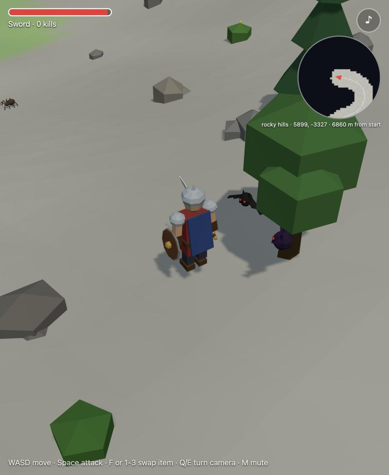

There is no edge. The world is a pure function of `SEED` and coordinates, so any place regenerates identically on
every visit and every page load, and nothing generated needs storing. It's one self-contained block in
[src/game.js](../src/game.js) (`// ---------- world`):

- **Noise.** `hash(x, z, seed)` is an integer hash (`Math.imul` mixing), so it stays exact at any coordinate (the old
  `sin()` hash loses precision far out). `noise()` is smooth value noise on it.
- **Regions.** Two slow fields, `wet` and `rough` (a feature every few hundred units), pick the region: **meadow**,
  **forest**, **rocky hills** or **lakes** (`region(x, z)`, each about a quarter of the world). `height()` is four
  layered base terrain built on the same two fields (see [Terrain](#terrain)); about a quarter of the world is water.
  `ground()` colours a point by height and slope and is shared by the terrain and the minimap.
- **Chunks.** The world is cut into 40×40-unit chunks. Each frame `stream()` drops chunks more than 4 away from the
  player, builds at most two missing chunks within 3 (nearest first), and refills the scenery instances. A chunk is a
  terrain mesh (26×26 vertices, coloured per vertex) plus an instance list and colliders. Neighbouring chunks
  sample `height()` at the same edge points, so seams match exactly (checked: zero difference along a shared edge).
- **Scenery.** A chunk's contents come from `rng(hash(cx, cz))`: 70 candidate spots, each drawing a fixed number of
  random values whether or not anything grows there, so the result never depends on build order. What grows depends
  on the region (`FLORA`: dense pines and oaks in forest, boulders in rocky hills, bushes by lakes, sparse meadows). The
  16 tree, rock and bush variants are compiled once, and each is one shared `InstancedMesh` that every live chunk
  writes into, so walking around adds no draw calls (about 40 in all).
- **Water** is one flat sheet that travels with the player: the water level is the same everywhere, so this matches
  per-chunk water and costs one mesh.
- **Monsters by region.** The spawn point's region picks the kind (`FOES`: spiders in forest, goblins and bats in the
  hills, slimes by the lakes), and the player's region scales the crowd (`CROWD`: forests are busier, lakes quieter).
- **Gentler near home.** Distance from the start (Oakdale) scales the wilds, on top of the beams' stages
  (models.json `"wilds"`): at home the crowd is `homeCrowd` (35%) of normal and each creature's fierceness is
  `homeFierce` (0.5), both ramping to full `homeRamp` (400) units out. Fierceness scales a creature's health and damage,
  how far it spots you and how often it strikes, set from where it spawns (cave guardians too). Starting over after a
  fall isn't a swarm.
- **What's remembered.** Only what can't be derived: the minimap's set of revealed 8×8-unit cells (one short string
  each, a few thousand after a long walk). Everything else is rebuilt from the seed: live chunks are the 49–81 around
  you, and the minimap's chunk pictures are a 150-entry cache. Player changes to the world (felled trees, opened chests)
  would go in a similar keyed set and be applied in `grow()` after generating.

**Points of interest** are now layers over the terrain: see the next section.

**Checked in the browser** (via `window.game`, which now also exposes `scene`, `renderer` and `world`):

- Teleporting to (10000, 10000), elsewhere, and back gives the same chunk (same trees, same heights), and a fresh page
  load gives the same signature.
- After teleports to ±10 km and a 1,200-unit walk, `scene.children` stays at 85–110 and live chunks at 49–81.
  `renderer.info.memory.geometries` stays roughly flat: 171 before, 153 after the walk, 240–350 across teleports
  (live chunks plus monsters). That needed a fix in `spawn()`: monsters left behind are now disposed of (their
  geometry and material), where before every respawn leaked one compiled model. `hold()` in the compiler likewise frees the
  prop it replaces, so item swaps and village stows no longer leak (12 swaps and 5 village trips: +0 geometries).
- Frame time while walking at 40 units/s: median 8.3 ms, worst 9.4 ms (120 Hz display); chunk building never showed
  up as a hitch.

## Villages and roads in the seeded world

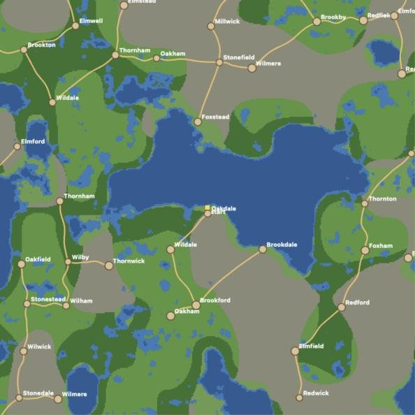

Villages and the roads between them are two more pure layers over the terrain, so the same seed gives the same
settlements and routes wherever you walk, and nothing about them is stored. The design and the options weighed are in
[docs/world-layers.md](world-layers.md). In short:

- **Settlements** sit on a grid of 280-unit cells centred on the start. `site(gi, gj)` gives each cell a seeded
  ~60% chance of a village, tries up to four jittered spots in the middle of the cell, and keeps the first that is dry
  and gentle (tested on `terrain()`, the terrain before villages and roads). It also fixes the radius (12–18), house
  count, name and seed. Cell (0, 0) always has a village 27–37 units from the start.
- **Roads** join villages in neighbouring cells when no third village is nearer to both (a relative-neighbourhood
  graph: short links, no crossings). `links(gi, gj)` returns the roads a cell owns, always built from the same end,
  so a road comes out the same whichever chunk asks. A road is a polyline from fence to fence, bent by seeded noise
  (straight at both gates). Roads more than a quarter under water are dropped; shorter crossings become causeways.
  The start has a short spur to the first village.
- **One height function.** `height()` is `terrain()`, graded level across the nearest road (blending back over 4 units),
  then levelled under nearby villages (over 8 units). It's pure, so chunk seams still match exactly. Each 40-unit
  chunk area caches the villages and road segments that can reach it, so `height()` stays a map lookup and a short
  loop. `ground()` tints road strips dirt, and scenery stays off roads and villages.
- **Streaming.** A village is built (houses, rooms, fence, well, townsfolk) when you come within 150 units and
  disposed of past 200. One collider walks the built villages: monsters are kept out of every village, the weapon is
  stowed in any of them, and spawning avoids every site, built or not.
- **Minimap.** Roads show as you reveal the ground they cross, and a village gets a ring and its name once you've
  seen its centre. The revealed-cell set is still the only remembered state.
- **Townsfolk talk.** Within `talk` + 1 (2.8) of a villager, the nearest one stops and turns to you; no prompt, it's
  for the player to find. Space (or HIT) opens a box with their line and pauses the game; Space, Enter, Esc or a tap
  closes it. An unlit well takes Space first only when it can act (a beam to aim, or a sunstone in the bag). The sage keeps its sunstone hint and takes no role. Roles cycle by index from `talk.roles` in `models.json`:
  a mission giver (the goal), guides and greeters, with lines picked by seed from `talk.mission`, `talk.guide` and
  `talk.greet` (`@` is a village name). A guide names the nearest unseen village without a lit beacon and reveals a
  circle round it (the same `reveal()` as sight), never the road. Each villager's line is fixed once heard, so a guide
  reveals only once. Seen villages off the minimap's edge show their name on its rim, pointing the way, and
  the big map (N) zooms out to include the villages guides have named.

| a road into Wildale's gate | the minimap after walking two roads |
|---|---|
| 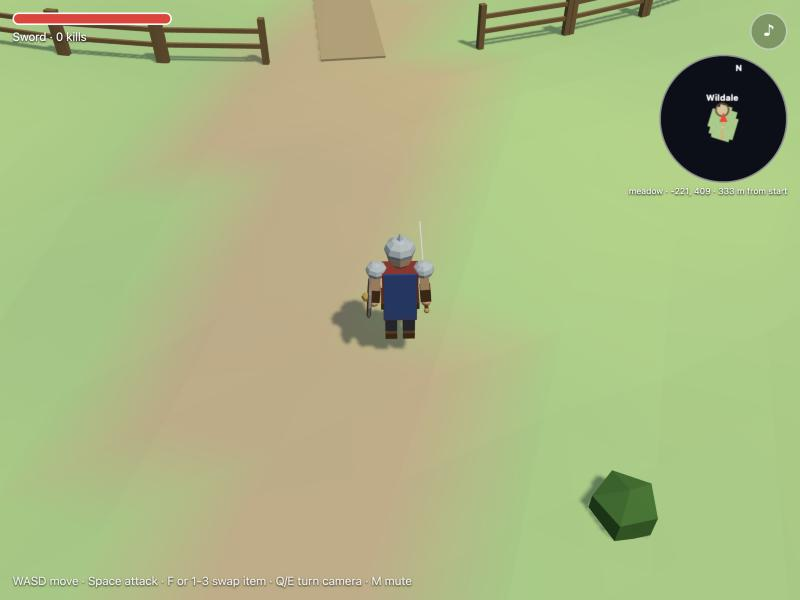 | 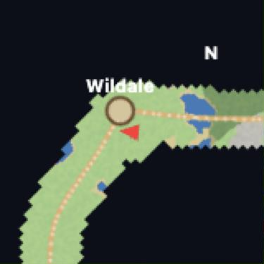 |

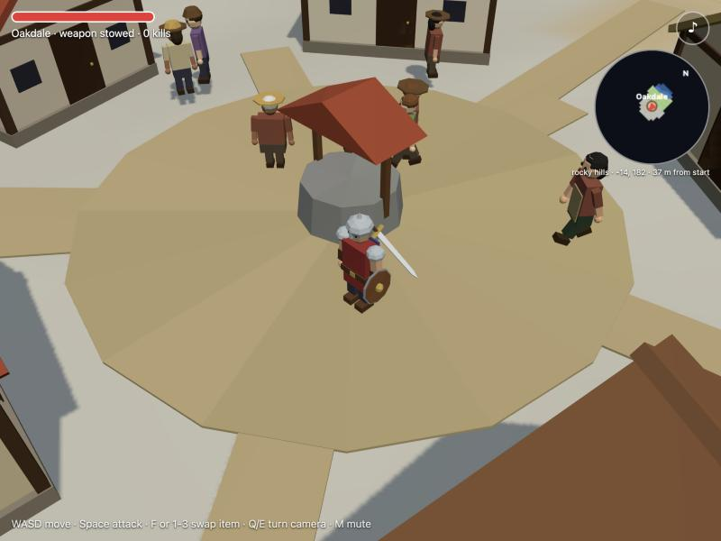

**Checked in the browser** (via `window.game`; the browser pane was hidden, so the loop ran on `setTimeout`):

- **Seams:** zero difference on all 2,652 shared edge vertices of the live chunks, including chunks a road crosses.
- **Regeneration:** a chunk on the Oakdale–Wildale road and the built village of Wildale (house positions and sizes,
  name, townsfolk count) are identical before and after a tour of six other villages and a teleport 25 km away.
- **Following a road:** walking the 270-unit Oakdale–Wildale road vertex by vertex keeps the player on the road's
  centre line (distance 0) and on its grade. Village names, weapon stowing, a door into a non-start village and back
  out all work. Monsters stayed at least 2.7 units outside the fence.
- **Memory:** three round trips between Wildale and a point 6 km away: 201–251 geometries near the village, 108–115
  away, 1 village built then 0. Site, road and chunk-context caches are capped and rebuilt from the seed on demand.
- **Cost of `height()`:** about 3 µs a call on scattered points against 1 µs for bare terrain. On a chunk's vertex
  grid it's under 0.2 µs either way.

Cost: game code +7.6 KB raw (39.9 → 47.5 KB, much of it comments), so roughly 0.8 KB shipped at ~90%. No model changes.

Known gaps: names come from 100 syllable pairs, so they repeat (21 repeats among 76 villages within 1.7 km). Some
villages have no road because their neighbours are missing or the way is wet. `hash()` in the world code returns the
same value for `(x, z)` and `(-x, -z)` when both are odd, so the settlement layer keys cells through `h2()`; chunk
scenery still has that mirror symmetry.

## Exploration minimap

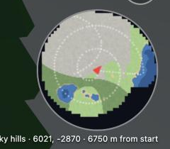

Top right, under the mute button, a round 160-pixel map shows 320×320 units around the player at 2 units per pixel.
Ground you've been within 36 units of is drawn in the world's own colours: deep and shallow water, sand, meadow, forest
(darker), rock. The rest stays dark (fog of war). A dotted trail of your last 300 steps, a yellow square at the
start and a red arrow for your facing sit on top. Below it: the region, your coordinates and how far you are from the
start, e.g. `rocky hills · 5899, -3327 · 6860 m from start`.

It **turns with the camera**: up on the map is the way the camera looks, which is the way W walks, so the red arrow
points up when you walk straight ahead. An **N** on the rim shows where north (−z) is. (A north-up map was tried first,
but the camera's default 45° turn made "straight ahead" point northwest on the map.) The explored ground is composed
world-aligned on a slightly larger hidden canvas and drawn turned in one `drawImage`, so chunk tiles never show seams.

It's drawn on a 2D canvas without reading back WebGL. Each revealed cell is painted once into a small per-chunk canvas
by sampling `height()`, `region()` and `ground()` 16 times. Each frame the visible chunk canvases are blitted, the
trail drawn on top, and the result drawn turned by the camera's yaw. The chunk canvases are an LRU cache of 150: an evicted one is repainted from `seen` when
you come back into view, so leaving and returning shows exactly the ground you explored.

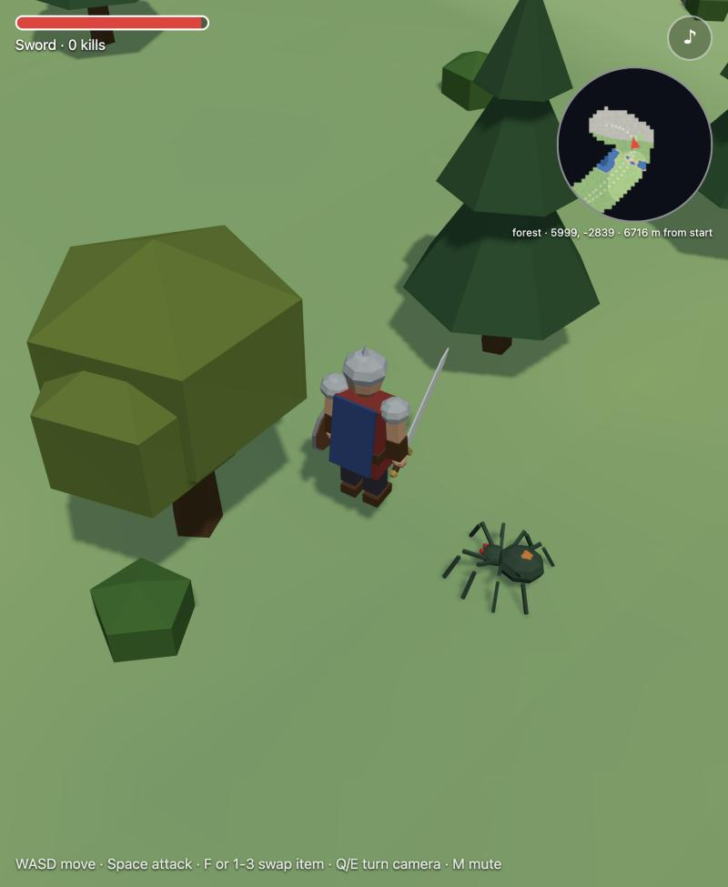

Cost: about 8.2 KB raw (game code +7.9 KB, HTML/CSS +0.3 KB), including the disposal fix and the region tables. Not
measured with surprisal; at ~90% that's roughly 0.8 KB shipped.

## Mounts

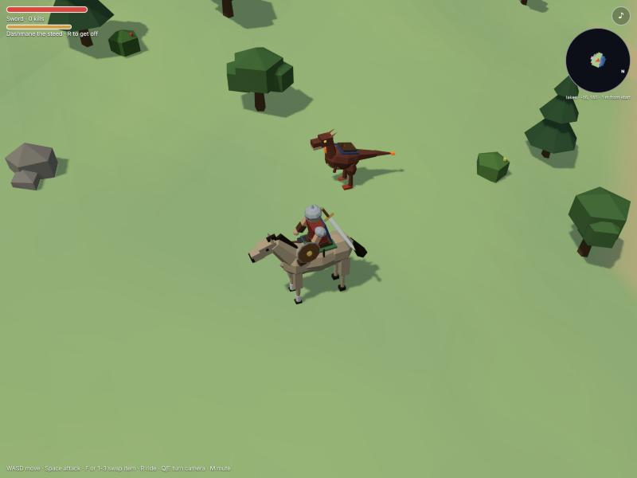

Two original rideable creatures live in `models.json`. Both are ordinary models with bones, rigid parts and keyframe
clips, a `saddle` socket bone, and their gameplay numbers in `vars`. Each one varies by seed: size, coat or scale
colours, mane, blanket and name, plus extras that roll a chance (a steed's brow horn and white socks, a drake's stubby
wings).

| | steed | drake |
|---|---|---|
| shape | four-legged, long neck, mane, saddle and stirrups | small two-legged dragon: long tail, horns, spines, embers glowing in its throat and tail tip |
| run / turn | fast: 10.5–12.5 units/s, 3.4–4 rad/s | slow: 6.5–8 units/s, 2.4–3 rad/s |
| attack | **rear and trample**: rears up, paws, comes down on whatever is in front (4 damage, reach 2.8, wide arc, big knockback, ~1 s cooldown) | **fire breath**: pulls its head back, then a short cone of flame (1 damage + the torch's 4 s burn, reach 4.2–5, narrow arc, ~1.4 s cooldown) using the torch's `f60`/`fd4` glow colours and light |
| health / grip | 30–38 / 8 | 40–52 / 12 |

Clips: `idle`, `walk` (a gallop or a stride; Actor blends it by speed), `attack` and `hit` are per model. `death` is the
shared `common` one (rolls onto its side). The rider's sitting pose is a `ride` clip in `common`. It only sets
`leg*`/`foot*`/`arm*`/`chest` rotations, so it ports to any rig that keeps those names (the warrior's bones are untouched),
and goblins use it too.

**Finding one.** Each streamed chunk rolls once, from its own seed, for a wild mount: about one chunk in 17, on dry ground
outside the village. Meadows and lakes get steeds, forests and rocky hills get drakes. About one goblin in five spawns
riding one. Hit the goblin and it falls off, and the mount bolts and is then free to take.

**Riding.** Walk up to a free mount: the HUD shows `R · ride <name> the <kind>` (on touch, the RIDE button). Press R to
climb on. The warrior's hip sits on the saddle socket in the ride pose, his weapon goes on his back (the village stow),
and the HUD shows the mount's name and health bar. A/D or the stick's x turn the mount (reins, see [Chase camera](#chase-camera)); in the free camera
the stick or WASD turns it toward the direction you hold, at its own turn rate, and it runs along its facing with a little momentum, slowing in tight turns. Space or HIT triggers
the mount's attack, with damage, reach, arc, knockback, cooldown and hit timing (`at`, a fraction of the clip) all from
its vars. R again climbs off and leaves it standing.

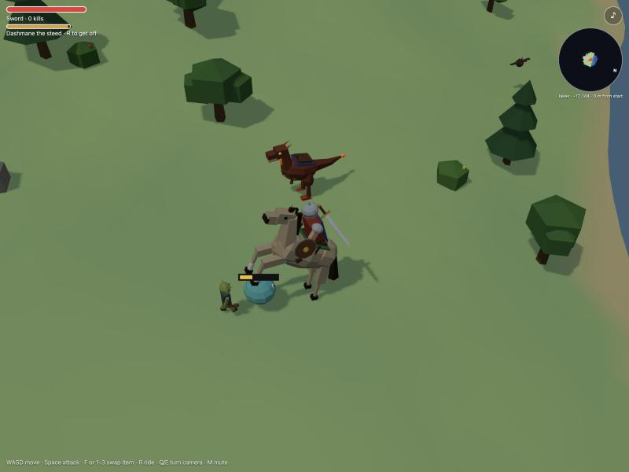
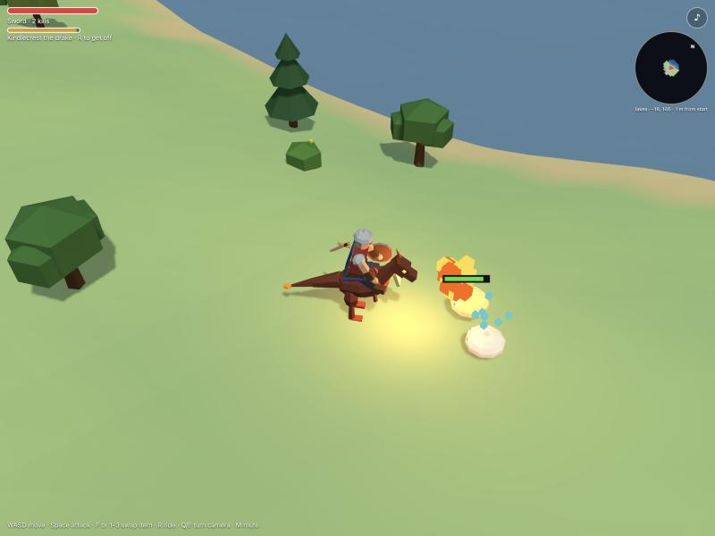

**Rules**

- **Villages: no.** Mounts are turned away at the fence like monsters, so you get off outside and walk in (weapons are
  stowed there anyway).
- **Water: wading only.** A mount won't step where the ground is more than 0.2 below the water line. This leaves room
  for a swimming rule later.
- **Camera:** 1.35 times further back while riding, so a fast mount has room to see ahead.
- **Who gets hit:** monsters chase the rider, but their blows land on the mount, which shields you. Damage taken in
  quick succession (it decays by 1 a second) that reaches the mount's `grip`, or the mount dying, throws you off. You
  land beside it and it bolts for 3 s, then wanders and can be mounted again. Monsters ignore riderless mounts. You can
  hit a riderless mount yourself (it bolts) and kill it, which doesn't count as a kill.
- **Persistence:** a wild mount leaves when the chunk under it unloads, and its chunk rolls it again when rebuilt (same
  seed, same mount). The last mount you rode (`tamed`) never despawns and stays where you left it, even kilometres
  away. A chunk whose mount you took or killed never rolls another. A goblin's mount leaves with its goblin.

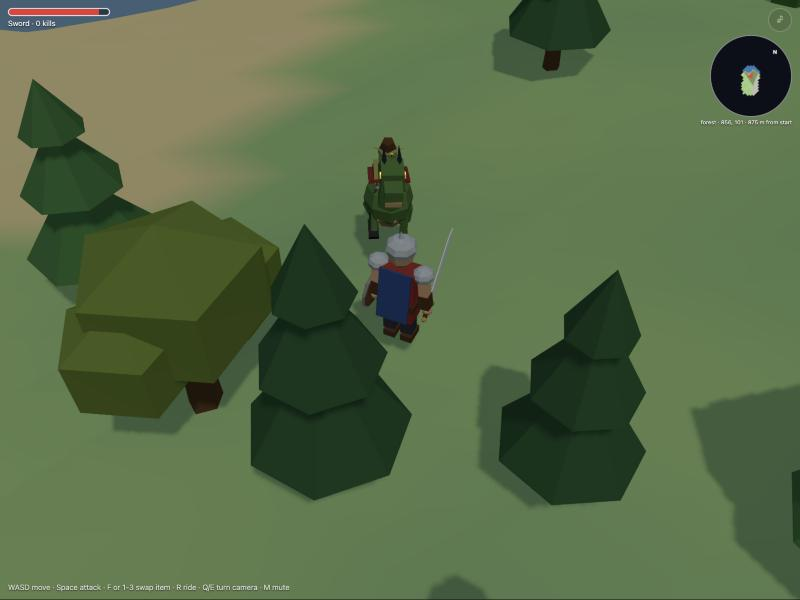

For play-testing: `game.addMount('steed' | 'drake', seed, x, z)`, `game.seat(actor, mount)`, `game.mountUp()` and
`game.mounts`.

Cost: about 35.5 KB raw. Most of it is the two models in pretty JSON: `models.json` +26.1 KB, a lot of which is
indentation and repeated keys. The rest is game code +9.1 KB and HTML/CSS +0.3 KB. Not measured with surprisal; at ~90%
that's roughly 3.5 KB shipped, the largest single feature so far. Trimming parts (socks, horn, spines, stirrups) would
be the first cut if space gets tight.

## Gold

| | |
|---|---|
| 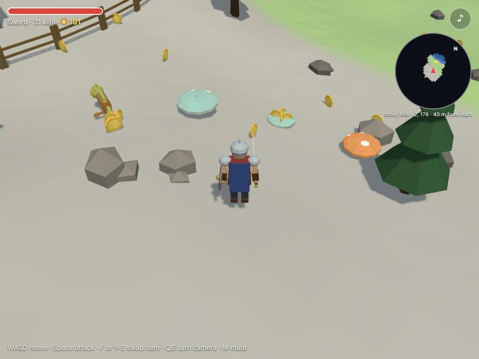 | 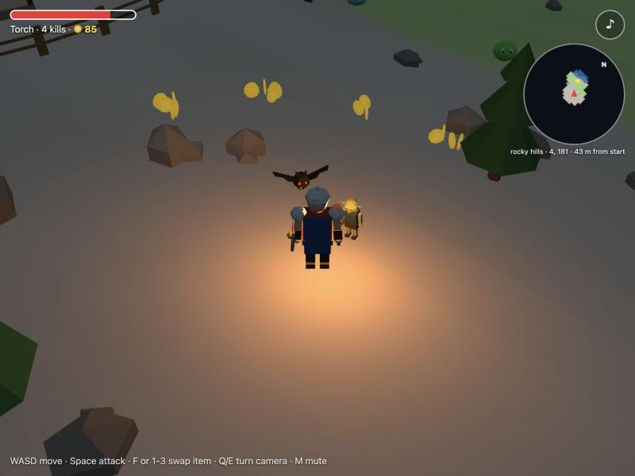 |

Every kill spills a few gold coins. What it pays is data plus a seeded roll:

- **Base by kind:** a `gold` var on each monster in `models.json` (slime 2, bat 2, spider 4, goblin 5), scaled by the
  creature's size the same way its hit points are.
- **Variance:** ×0.7 to ×1.3, from `hash(monster seed, kill count)`, so it's seeded per kill.
- **Night:** up to ×1.6 at full dark, on top of the bigger night crowds.
- **Region:** `PAY` next to `FOES`/`CROWD` in `game.js`: meadow ×1, forest ×1.2, rocky hills ×1.4, lakes ×1.1 (the
  tougher mixes pay more).

The total is split over up to six coins (the `coin` model in `models.json`: two flat cylinders, baked once and shared).
They burst out and bounce, then sit spinning with a soft pulsing glow. Within 3.5 units they're pulled to you, faster
the closer they get, and pay out with a two-tone "ching" and a gold sparkle. A coin blinks after 40 s and is gone at
45 s, or as soon as the chunk under it unloads. The HUD shows a coin icon and your purse next to the kills, popping on
each pickup.

The purse is kept in `localStorage` (`warriorGold`, every access in try/catch), so it survives a reload. **Falling costs
a tenth of your purse** (rounded down; the counter flashes red). It's enough that dying matters, and mild because you
also lose your ground and walk back from the start. `game.gold` reads or sets it from the console, and `game.coins`
lists the live coins.

**Spending it later** (not built; villages are still changing):

- **Merchant** in the village square: buy the axe and the torch instead of starting with all three, plus upgrades
  (sharper, longer reach, longer burn). It fits the existing item `vars` (`dmg`, `reach`, `burn`) as a price list.
- **Potions:** a quick heal for a few coins, carried as a stack and drunk with a key. It's the natural sink for night
  runs.
- **Inn:** pay to sleep, which heals fully and skips to morning (moves the day clock), and maybe sets the respawn point
  to that village.
- **Healer:** pay to have your wounds healed at once instead of waiting for the slow regen.
- Prices could scale with distance from the start, matching the richer, tougher regions further out.

Cost: about 4.2 KB raw (game code +3.2 KB, models +0.8 KB of pretty JSON, HTML/CSS +0.3 KB). Not measured with
surprisal; at ~90% that's roughly 0.4 KB shipped.

## Terrain

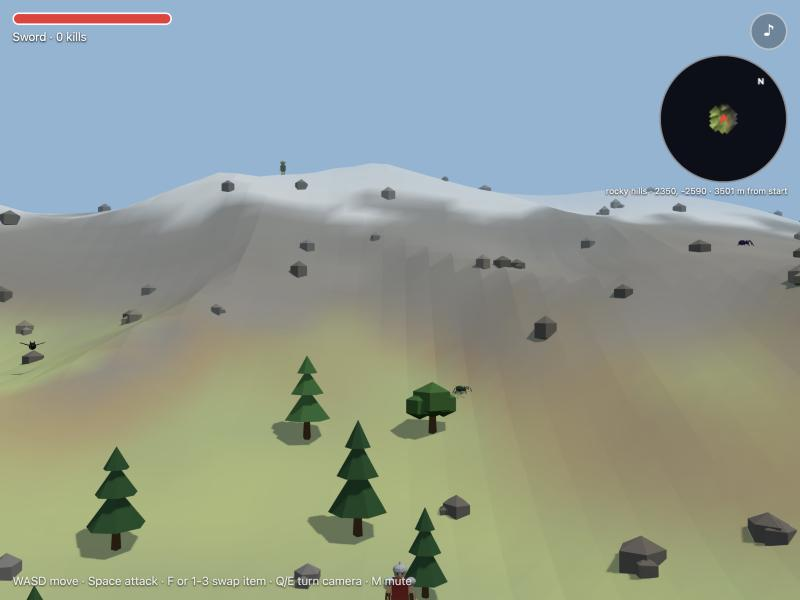

The old height was four octaves of small noise: 98.5% of land had a slope under 0.3, and the highest point anywhere
was 22 units, so the world read as flat. Height is now `height(x, z) = flatten(x, z, terrain(x, z))`: `terrain()` is a
self-contained base terrain, and anything that levels ground (the village today, roads later) layers on top in
`height()`. Still a pure function of `SEED` and coordinates, all cheap value-noise math. The layers in `terrain()`:

- **Domain warp.** The sample point is pushed up to 35 units by two slow noise fields, and each fBm/ridge octave is
  turned 37° from the last, so hills and ridges don't line up with the noise grid.
- **Rolling hills.** Four-octave fBm with an amplitude that follows the regions: about ±5 in meadows, ±7 in forests,
  more in the highlands. On top, two octaves of **knolls** (about ±5 over 30 units), small enough to show up in the
  ~25-unit view of the follow camera; the big hills alone looked flat from there.
- **Mountain ranges.** Where `rough` is high (the rocky hills region), a highland mask fades in three octaves of
  ridged noise (`1 - |2n - 1|`, squared): sharp crests up to about 40 units, with valleys between them.
- **Lake basins.** Where `wet` is high (the lakes region) the ground sinks up to 9 units below the hills.
- **Rivers.** Where a very slow, separately warped noise field crosses 0.5, a narrow band is carved below the water
  line, so rivers wind for kilometres through lowlands (never across mountains) and join lakes. Mounts won't wade
  deeper than 0.2 below the surface, so the river bed rises to just under it at **fords**, where a slow noise is
  high: about a quarter of river length, every 50–100 units along a river. A steed stops at a deep stretch and
  crosses at a ford (checked in the browser).
- **The start.** Within about 150 units of the origin, lakes and rivers fade out, so the start is dry land (this seed's
  origin sits in a big lake region, so the start is a hilly island about 200 units across with a neck south to the
  mountains). Mountains fade in from 35 to 90 units out, and hills and knolls flatten only on a pad within 10–35 units,
  so you start on level ground and walk into hills within a few seconds. The village ring is still levelled flat.

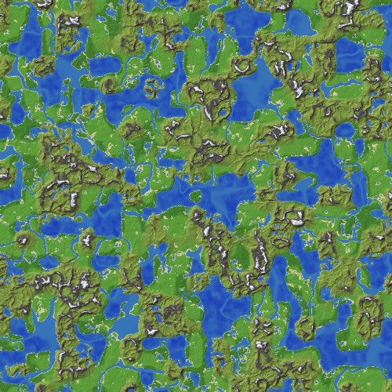

Measured over 6×6 km (every 8 units): land with a slope under 0.3 went from 98.5% to 64%, 0.3–1 is 35%, 1–1.5 is
0.8% and nothing is steeper, so cliffs are rare and nothing needs blocking. Heights run from −10 (lake beds) to 40
(peaks); water is 35% of the area (was 28%). Regions are unchanged, so flora and monsters still match the ground.

**Ground colour** (`ground()`, per vertex, also used by the minimap) follows height and slope: sand by the water;
grass that blends smoothly from meadow green to dark forest green to dry highland olive (so region borders no longer
show as hard circles); dirt on slopes over about 0.4; rock on slopes over 0.65 or above about 20 units; snow above
about 30 units, unless the slope is steep. `slope()` takes the height difference across 2 units in x and z, the same
everywhere, so colours match across chunk seams. Each boundary wobbles with noise so none is a straight contour line.
Trees and bushes don't grow above 17 units (only boulders).

**Baked hillshade.** The follow camera looks steeply down from close by, and three's lighting alone barely shades a
gentle slope, so the ground read as flat. Each chunk's vertex colours are also multiplied by a hillshade lit from the
sun's side (0.6–1.3), so slopes facing away from the sun are visibly darker even where they are gentle.

**Minimap relief.** Each revealed map pixel is now the ground colour, a little brighter with height, times a hillshade
lit from the north-west, and water darkens with depth. The colours are written without three's sRGB lift
(`getHexString(LinearSRGBColorSpace)`), which keeps the map's contrast. It is still painted per chunk into the
same 150-tile LRU cache as cells are revealed, behind the same fog of war, so memory stays bounded.

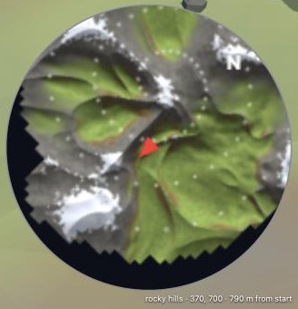

**Checked in the browser** (via `window.game`, which now also exposes `world.terrain`):

- Teleports to a summit, a mountain range, rolling forest hills, a river, a lake shore and open meadow:
  [mountain](terrain-mountain.jpg), [range](terrain-range.jpg), [hills](terrain-hills.jpg),
  [river](terrain-river.jpg), [lake](terrain-lake.jpg), [plains](terrain-plains.jpg), and
  [night on a snowfield by torchlight](terrain-night.jpg). Overview shots use a raised camera; the game camera
  is unchanged.
- Seams: 0 height difference along 52 shared chunk edges. All 1,553 live scenery instances and every actor sit exactly
  on `height()` (or on the water floor).
- Rebased onto the mounts and new-skeleton main: a steed ridden 308 units over a range (y 11 → 32 at the crest → 15)
  stays exactly on the ground with the rider seated, and the minimap relief draws while riding.
- Chunk build: 1.3 ms, up from 0.29 ms (ground colour samples the slope, four extra heights per vertex); at most two
  chunks build per frame. `height()` costs about 0.29 µs, up from 0.16 µs. Frame rate couldn't be measured, because
  the browser pane was hidden and paused rendering; the checks ran in an iframe with a timer standing in for
  `requestAnimationFrame`.

Cost: about 3.5 KB raw in `src/game.js` (52,280 → 55,763 bytes on top of the gold main, fords, knolls and baked hillshade included). Not
measured with surprisal; at ~90% that's roughly 0.3 KB shipped.

## Swimming and habitats

| | |
|---|---|
| 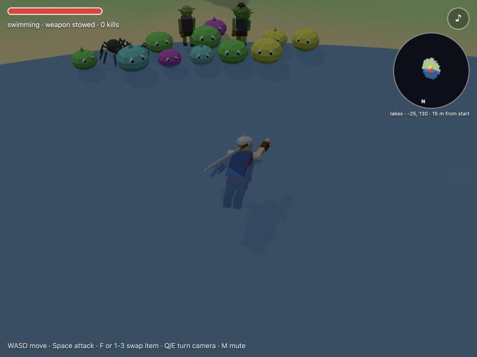 | 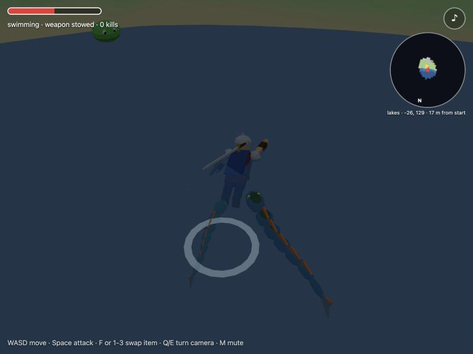 |

Where the ground drops more than a unit below the water (`SWIM = WATER - 1`), the warrior **swims**. He sinks to
his shoulders at the surface, moves at 55% speed and plays the warrior's looping `swim` clip: body pitched forward,
alternating arm strokes that bend at the elbow, a flutter kick with the knees nearly straight. Clip channels add to
the rest pose, so each channel first cancels the fighting stance (bent knees, raised forearms, turned hip) and then
adds the stroke. His **weapon is stowed** on his back (the
village's stow, reused), so a lit torch goes out, and he **can't attack**. Going in throws up a splash of droplets, a
ripple ring and a filtered-noise splash sound. While he swims he leaves a wake of ripples. Shallower water is
wading: he stands on the bottom, keeps his weapon and can fight. A rider never swims, because mounts already refuse
water deeper than a wade.

**Breath:** a thin blue bar under the health bar appears while you swim. It lasts 25 s and refills in 4 s on land.
With no breath left you lose 1 hp every 2 s, and health doesn't regenerate while you swim. I kept it gentle on
purpose. Its job is to stop you from treating the lake as a safe room, not to punish you. It's not fun to drown
while crossing a lake to explore, and 25 s covers most crossings.

**Habitats** are a per-kind test on the ground height (`HABITAT`, default `onLand`), applied in `Actor.move`. A move,
an AI step, separation from other monsters or **knockback** that would end in the wrong medium slides along the
shore or stays put. No code path pushes a creature in.

- **Goblins, slimes and spiders** stop at the waterline, ankle-deep at most. When the way to a swimming player is
  water, they pace up and down the shore facing him. After 3 to 5 s they lose interest and wander off for 5 to 9 s.
- **Bats** fly over water, but only a short way. After 4 s over water they turn back to the last shore they crossed.
- **Eels** (`eel` in `models.json`) are new: a seeded water serpent built from a head and a six-segment chain with
  fins. Their `idle` and `walk` (swim) clips are a travelling wave made from phase-shifted sine keys, one channel per
  segment through `repeat`, with the back at the surface. Their `attack` lunges the head out of the water. They
  spawn only where the water is deep (more than 1.5 below the surface), four at most at a time, and they never enter
  water shallower than a swimmer's. They chase and bite only someone who is in the water, so climbing out is the way
  to escape. Water puts out a burning eel. They have health bars like other monsters, but you can only hit one from
  the shallows, because a swimmer can't attack. An eel bite does 1 damage.
- **Spawning** picks a spot first, then a kind that lives there: eels in deep water, the region's land mix on dry
  ground, and nothing in the shallows or the village. This covers respawns, despawn-and-replace and night crowds,
  which all go through `spawn()`.

**Gold in water:** coins that land in water sink slowly (about 1 unit/s) and settle on the bed instead of floating.
They stay collectable: for a swimmer the pickup radius ignores depth, so swimming over sunk coins pulls them up from
any depth. Eels pay 3 gold (a `gold` var like the other monsters), though you can only kill one from the shallows.

The camera stays at its usual height over the swimmer, about 6 units above the surface. The lake bed shows through
the 75%-opaque water, eel shadows included.

Cost: about 14.8 KB raw. Game code is +5.6 KB and HTML/CSS +0.16 KB. Models are +9 KB of pretty JSON: the eel is
about 5.2 KB and the swim clip about 2.2 KB, plus indentation. Not measured with surprisal; at ~90% that's roughly
1.5 KB shipped.

## Chase camera

The camera stays behind the hero. A/D (or the stick's x; mouse drag-to-turn was later removed) turn him at 2.8 rad/s, W/S walk along his
facing (backing up at 60% speed), and the camera swings round to sit behind him with a short lag (it
closes 4 × the angle gap per second), so turns feel smooth rather than bolted on.

| | |
|---|---|
| 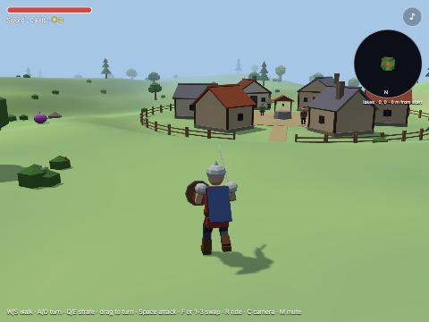 | 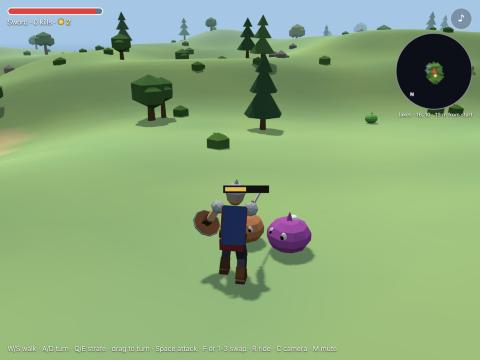 |
| 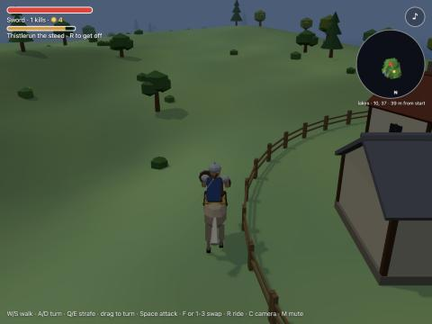 | 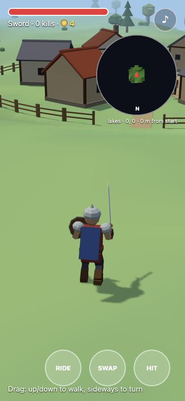 |
| 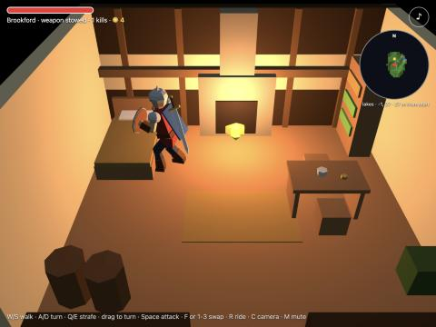 | 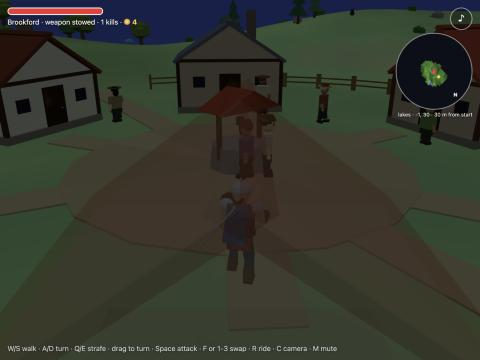 |

- **Framing.** 7 units back and 4.8 up, looking at a point 3 units ahead of him at waist height: a slight downward
  angle that shows the ground ahead and monsters in front instead of the hero's back. If the ground behind is
  higher, the camera rises to 1.5 above it, and it never goes below the water.
- **Combat.** With no free aim, a swing turns him toward the nearest live monster within 4 units and about 57° of his
  facing, so you only need to roughly face a fight.
- **Riding.** Reins: A/D turn the mount at 80% of its own turn rate (on the spot too), W runs at its speed, S backs
  slowly. The camera pulls back 1.35×, as before, and the hero's facing follows the mount's, so the minimap arrow
  and the camera agree.
- **Phones.** On a portrait screen the camera pulls back 1.3× so the hero doesn't fill the view.
- **Village rooms** keep their fixed cutaway camera, and moves there stay screen-relative, because a chase camera
  would be inside the walls of a 6-unit room. On leaving, the camera snaps behind the hero at the door; the house
  behind him turns see-through like any house between the camera and the player.
- **Swimming.** Same turning controls in deep water, at the swimmer's 55% speed; the camera stays above the surface.
- **Minimap.** It still turns with the camera, so up on the map is the way the camera looks; it lags with the camera,
  matching the view.
- **First person.** C switches to it (caves always use it): the camera just in front of the warrior's face, A/D
  strafe, and a click locks the pointer so the mouse or trackpad looks around and a click attacks. Riding, the camera rides out in
  front of the mount's head instead (1.1x its size ahead, a little above), so the neck and head stay out of view and a
  drake's breath flames out below and ahead. There are no Q/E keys and no mouse drag-to-turn in any mode.

Cost: about +2.4 KB raw in `src/game.js` (58,139 vs 55,763 bytes, much of it comments) and +29 bytes in the page
shell; at ~90% compression, roughly +0.24 KB in the shipped build.

## Water depth

Water used to read as a flat sheet that never got deeper. The base terrain did slope down in lakes, but two
things hid it. `Actor.update` clamped every actor at `WATER - 0.35`, so the warrior never sank more than ankle-deep however far
out he walked. The water was also one flat, uniformly coloured, 75%-opaque plane, with sand under it everywhere, so a
metre of water looked the same as ten.

- **Bed shaping:** `shore(h)` runs after `terrain()` in `height()`. It remaps depth below `WATER` pointwise:
  `d * (0.7 + smooth(0.8, 2.5, d) * 1.5)`. The first ~0.8 units of base depth become a shallow wading shelf, then
  the bed drops off to about 2.5x its base depth. It is a pure function of the base height, so it is deterministic,
  seam-safe (0 difference across 894 underwater shared chunk-edge vertices) and costs one smoothstep. River fords stay rideable:
  their beds were at most 0.1 deep and become at most 0.07.
- **`depth(x, z)`** (exposed as `game.world.depth`) is `max(0, WATER - height(x, z))`.
- **Readable depth:** under water, `ground()` tints the bed from sand-teal to dark navy through `sea(c, d)`, with a
  pale foam band at the waterline. The water plane is now 60% opaque so the tint shows through. The minimap uses the
  same `sea()` colour: light teal shallows, dark deep water.
- **Wading:** actors now sink with the bed down to `WATER - 0.9` (about waist-deep), going ankle, knee, then waist.
  `wade(p)` slows movement and the walk cycle by up to 45%.

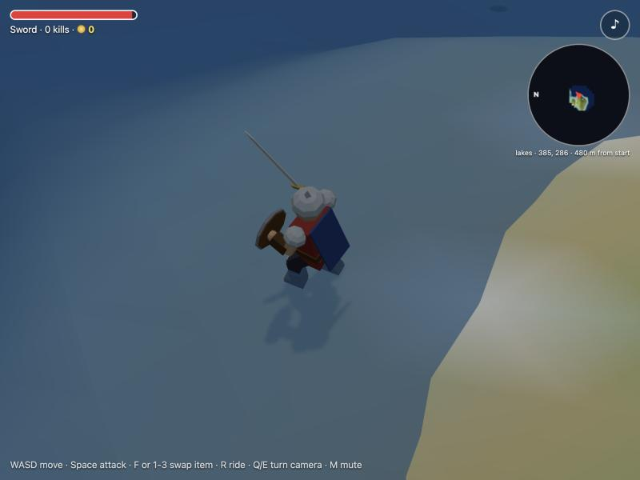
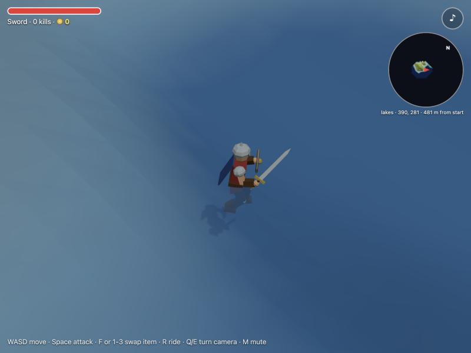
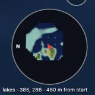

**How it sits with the other layers.** `shore()` runs on `terrain()` inside the road/village `height()`, before
grading and levelling, so roads and villages still flatten on top. Swimming starts where the ground drops below `SWIM`
(`WATER - 1`, that is `depth > 1`): the wade floor at `WATER - 0.9` hands over to swimming's `WATER - this.swim`. Eels
need `depth > 1.1`, and the deeper beds give them more room. `wade()` returns 1 while swimming, so it doesn't stack
with swimming's own 0.55 speed factor.

Cost: about 1.2 KB raw in `src/game.js` (71,581 → 72,770 bytes on top of swimming, villages and the chase camera), roughly 0.1 KB shipped at ~90%. Not measured with
surprisal.

## Tray, wood and the boat

A tray along the bottom holds the three weapons, then goods with counts (wood for now). Keys 1-4 or a tap pick a
slot: a weapon is equipped, goods are used (wood builds the boat). The bag is kept in `localStorage.warriorBag`, next
to the gold. A new kind of goods is an icon in `ICON` and a use in `GOODS`; the tray lists it from then on.

| | |
|---|---|
| 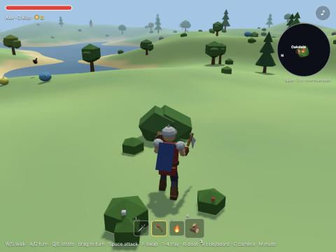 | 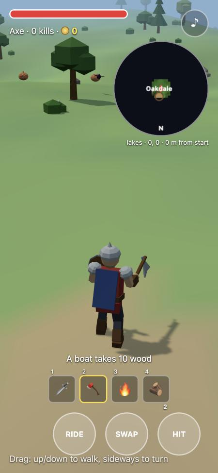 |
| 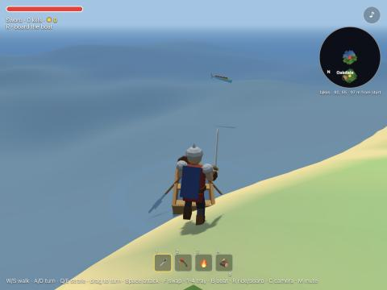 | 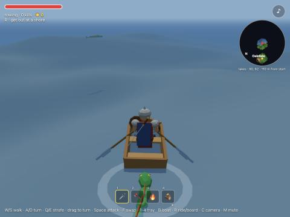 |
| 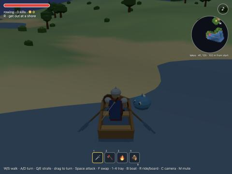 | 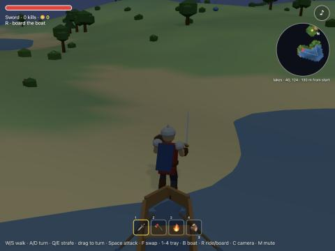 |
| 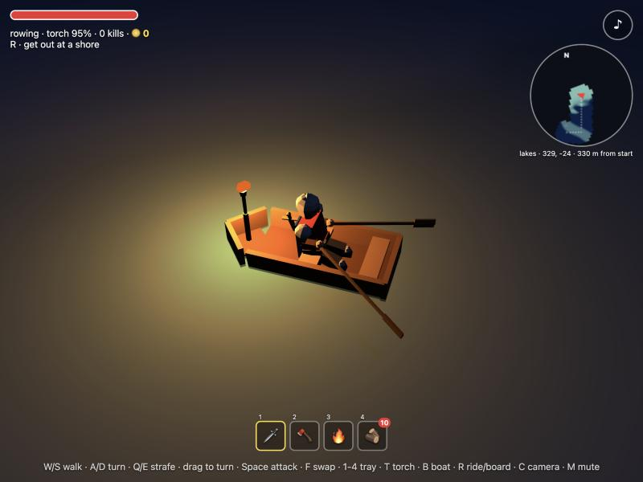 | |

- **Chopping.** The axe has `"chop": 1` in `models.json`; other weapons have no `chop` and pass through trees. A swing
  near a pine or oak (within reach, about 66° of your facing) hits it: wood chips, a thunk, and the tree shakes.
  The first hit moves that tree out of its InstancedMesh into a mesh of its own (same geometry and material), so only
  it moves. Three hits and it tips over away from you, crashes, drops 3 wood items along where the trunk landed
  (walk onto them to pick them up, like a tossed one) and sinks.
- **Felled stays felled.** Each tree is the n-th candidate spot of its chunk's seeded loop, so a felled tree is stored
  as `{ "cx,cz": { n: time } }` in `localStorage.warriorFelled`, and `grow()` skips it. Trees regrow after 30 minutes
  (real time): expired entries are pruned on load, so the record stays small however far you roam.
- **The economy.** `models.json` `tray.recipes` maps each item to its inputs, which can include `gold`: wood (20 gold) and
  flint (200 gold) are gold-only, a torch is 1 wood + 1 flint, a boat is 10 wood + 30 gold. Slot 9 lists every recipe
  with its cost, greyed when short; crafting and buying only work in a village (outside, it says "Craft in a village").
  The sword and axe are permanent and not for sale. The game keeps running while the panel is open: you can walk,
  fight and pick things up with it showing. Number keys still take items in hand; tapping or clicking two slots
  swaps them; Esc or 9 closes it.
- **The boat.** Slot 6 counts boats owned. Taking it in hand (key 6 or tapping the slot) lifts a boat over his head,
  upside down like a portaged canoe (the boat's `carry` var: its position and rotation in the hand, set in the held
  prop's rest pose so posing keeps it). Space throws it ahead like wood; where it lands becomes the boat (water or
  land), spending one from the tray. There is no B key. On land it sits on the ground without bobbing, and rowing a
  beached boat works the oars but moves and turns nothing. R boards it
  within 4.5 units, on foot or swimming; a rider gets off the mount first, so mounts never board. In the boat you sit
  on the thwart facing the stern and row (the warrior's `row` clip), A/D turn, W rows at 3 u/s (half walking speed) with glide, S backs slowly, and it runs aground
  rather than leave the water. R at a shore steps you out onto land; with no land within 4 units it says so.
- **What I chose.** No attacking from the boat: your hands are on the oars and the weapon is stowed. Land monsters
  stop at the shore as before, and their blows don't reach a boater even from the bank. Eels still circle the boat
  but can't bite through the hull. Bats can still swoop at you, but they tire over water as before. You never swim
  while in the boat, and breath refills.
- **Rowing with the hands.** The warrior's `row` clip (made in `tools/warrior.mjs`, 1.6 s) runs finish, recovery,
  catch, drive: hands drawn to the ribs with the elbows past the torso and a lean back, then hands low and away,
  a full reach leaning in, and the pull. It also turns him to face the stern (`root.ry` 180). Each frame after he is
  posed, `grip()` turns each oar in its lock (`oarL`/`oarR` on the gunwales) to point its handle at the opposite
  hand, so the hands never leave the oars and the blades follow the hands' height: they dip under on the drive and
  lift clear on the recovery. The stroke rate follows the speed (and A/D turning in place rows too). When you stop,
  the stroke runs on to the finish and rests there, blades raised. A beached boat ships its oars along the hull.
  Turning doesn't pull one oar harder: it would need a second, per-side phase.
- **Torch in the boat.** Both hands are rowing, so the shield is put away and, while the torch is your weapon and
  lit, it stands in a post at the bow (the boat's `post` socket), with the same flickering light, fuel, and monster
  fear and lure. Board with a lit torch and it goes to the post; step ashore and it goes back to your hand, lit.
  Picking another weapon in the boat puts it out; picking the torch lights it in the post again.
- **Persistence.** There is one boat: building another moves it. Its place and heading go in
  `localStorage.warriorBoat` when you throw one, when you get out, and on `pagehide`, so you find it where you left it.
  The chase camera needs nothing new, since the boat drives the hero's facing.

Cost: about +8.8 KB raw in `src/game.js` (81,542 vs 72,770 bytes, a good share of it comments), +1.3 KB in
`models.json` once minified (the boat is 1.2 KB of that), and +0.74 KB in the page shell for the tray CSS. At the
usual ~90% compression that is roughly +1 KB in the shipped build. That's an estimate: surprisal wasn't run here.

Rowing with the hands and the boat torch: `game.js` +1,064 bytes raw, `models.json` +3,265 pretty (+1,032 minified;
the `row` clip is most of it, the boat dropped its old oar clip). Estimate only: surprisal wasn't run here.

## Dark nights and the torch

At full night the world is near-black: the sky and fog go to `#03050c`, the fog closes in from 40-110 to 6-40, the
hemisphere light drops to almost nothing, and the sun turns into a faint blue moon (0.2) so silhouettes barely read.
Dusk and dawn are the same 3-minute cycle as before, everything lerped on `day`. What shows in the dark is what
glows: parts whose colour ends in `!` are self-lit (the compiler stores them as colour + 2 and a one-line
`onBeforeCompile` patch turns that into emission), so monster eyes, house windows, flames and hearths, and the coins'
pulse are points of light. A village is lamplit (a floor on the hemisphere light), and rooms ignore the fog, so
neither needs a torch. The minimap and HUD are unchanged and stay readable.

| | |
|---|---|
| 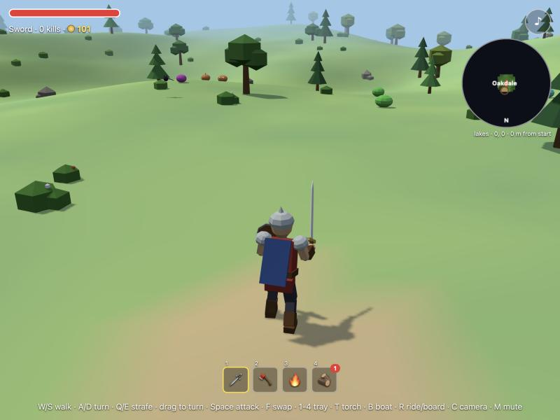 |  |
|  |  |
|  | |

- **Light it.** The torch is a weapon like the sword and axe, always with the shield: taking it in hand (its tray
  slot, F/Tab or SWAP) lights it, and switching to another weapon puts it out, keeping its fuel. There is no T key
  and no torch in the shield hand. A lit torch gives a warm flickering point light (two sines) around the hero, much
  stronger at night, so at night you choose between the sword or axe in the dark and the torch's light and fire.
- **Fire as a weapon.** A lit torch swing deals +2 damage (3 instead of 1), sets the 4 s burn and throws flame bits.
  Unlit, the torch is a weak club: 1 damage, no burn.
- **Fear and lure.** Within 7 units of a lit torch, slimes and spiders back off to about 5 units and circle the edge
  of the light, then dare a rush (2 s in every 7), so the light buys breathing room, not safety. Bats are drawn to
  it: they chase from 24 units instead of 12.
- **Fuel.** A torch burns for 150 s of being lit, shown as an orange bar under the health bar while it's lit. When it
  burns out it's spent: it leaves the bag (the torch slot's count drops by one). If you have another, take the slot
  again and it lights fresh; if not, craft a new one in a village (a wood and a flint). Putting a torch out keeps
  what's left of it.
- **Water and riding.** Swimming douses it (and you can't light it while swimming); ashore, take it again to relight
  it. On a mount you keep holding the torch, lit (any other weapon is stowed); in a village it is stowed as before. In the boat it stands in the bow post (see the boat).

Cost: about +2.9 KB raw (`game.js` +2,369 bytes, about 0.9 KB of it comments; `compiler.js` +456; `index.html` +64;
`models.json` +2 bytes minified, eight colours gaining a `!`). Estimate only: surprisal wasn't run here.

## The goal: beacons for the star

**Wellfire** is the game's name. The title screen is in the live world at dusk: the name in 3D voxel letters (drawn
into a small canvas, one box per lit pixel, coloured yellow to red) floats over Oakdale's well, a flickering flame of
additive cones and sparks rises from the well behind it, and the camera circles. The HUD is hidden, with only a start
prompt. Any key, click or tap starts the game and its audio and restarts the day at mid-morning; the warrior starts (and gets back up after falling) beside Oakdale's well. `home`, the world's origin for the village grid and "m from start", is unchanged. The lore: the star is an eye that watches, its brood grows bolder where no fire burns, and every well once held a fire
aimed at it. Five beams pin the eye and the night goes blind, which is the end screen's headline.

The game has an ending now. One bright star hangs at a fixed, seeded direction in the sky (about 15-40° up), as if
infinitely far away, so the right aim is the same from every village. Set your torch in the beacon on five villages'
wells, turn each beam until it meets the star, and the five beams start a light show and the end screen. The
design discussion and the other options weighed are in [docs/goal-ideas.md](goal-ideas.md).

- **Setting a beacon.** At a well (within 3.5 units), Space sets a torch and a sunstone in it (see
  [Rocks, caves and sunstones](#rocks-caves-and-sunstones)). Both leave the bag (the torch slot has a count; the
  first one is free), a fire bowl with a sunstone turning over it (the `beacon` model) appears on the well's roof, a
  pale beam rises, and you're aiming at once. Tips at the well say what it needs.
- **Aiming.** Setting the beacon takes the beam; Space at a lit, unfinished well takes it again; R or walking off
  lets go. The camera stands behind the sunstone and looks
  along the beam. Turning (A/D, drag) swings it round, W/S tilt it, and the warrior and the minimap turn with it. A
  `✦` on the minimap rim always shows the star's way. The locked mouse (in first person) tilts it too. The beam is white until it comes within
  about 7° (`LOCK`, 0.12 rad) of the star; there it snaps exactly onto the star, turns gold and locks, with a chime and a
  burst. Gold always means locked, and a locked beacon stays locked. A saved beam already inside that zone locks on load.
- **A new torch.** Flint comes from rocks (below). With a wood and a flint, slot 3 (or tapping the flint)
  makes a torch.
- **Beams from anywhere.** Every beam is drawn wherever you are, not only near its village. A far beam is moved
  toward the camera and shrunk by the same factor (12 / distance), which leaves its picture unchanged but keeps it
  inside the camera's 200-unit range. It is drawn long enough to run out past that range and fattened with distance
  so it stays visible. A locked beam is drawn from its well to the star itself, so its tip sits on the star from any
  viewpoint (the star is drawn a fixed way off the camera, so a beam merely parallel to it would end beside it). At night they are the brightest things in the world.
- **Progress.** `✦ n/5` in the info line, and village rings on the minimap turn orange when lit and gold when on the
  star.
- **The light show.** The fifth lock turns the camera up to the star. The beams pulse and cycle colours, the star
  swells, the sky flushes through hues, and sparks burst round the star. After 4 s the end screen lists the five
  villages in the order you set them, your gold, kills and distance from the start. A tap dismisses it and the world
  goes on.

### Rocks, caves and sunstones

Every beacon needs a sunstone, and each village's sunstone lies at the end of a dark maze in a cave out in its wilds,
guarded. Flint comes from ordinary rocks. Tuning is in models.json `"rocks"` and `"caves"`.

- **Rocks.** About `perChunk` (2.4) breakable rocks per 40-unit chunk, weighted by region, never in water, villages or
  roads, drawn with the scenery `rock` model, and in the way. Swing the axe at one and, like a felled tree, it breaks up
  and is gone, spilling what it held through the drop system: mostly a coin or two (`gold` 0.9, `coins` 1-2, times the
  stage's pay), rarely a flint (`flint` 0.1). Broken rocks are kept in `warriorFelled` as `"e" + index` with the time
  and grow back after 30 minutes (`REGROW`), as trees do.
- **The cave.** Each village has one, at a seeded dry spot `near`-`far` (40-200) units out (`den()`): a rocky mound
  whose dark mouth faces the village, sealed by a boulder. The boulder takes `hits` (8) axe blows (a ridden mount's
  attack counts), saying how many are left, then shatters. It stays open (`warriorFelled.caves`).
- **Going in.** Walk into the open mouth on foot with a lit torch (without one: "Pitch dark in there"). The screen
  fades and you're underground: the maze is built `depth` (80) units below the entrance, so the world above carries on
  unseen. Everyone inside stands on the cave floor and meets only its walls; the surface's creatures are gone, nothing
  spawns, and swimming, the minimap, the big map, mounts, the roc and the villages don't reach you. There's no sun or
  sky, only your torch (and the sunstone's glow), and the fog closes in at 18 units. The view is always first person
  underground (whatever C says): the camera rides just in front of the warrior's face, following his head, and the
  model is drawn as everywhere else, so his arms and weapon swing into view; a wide lens (90°, near plane 0.05), with the left arm and shield hidden so they don't fill the view.
  Beacon beams and the eye aren't drawn underground (they'd cut through the walls). Walls,
  floor and roof are rough rock, each a 64-pixel texture drawn in code at load (`rock()`: mottled patches, grit,
  hairline cracks) and tiled every 2 units on every face (`slab()`), so nothing stretches. A fall underground wakes
  you at home, the cave left behind.
- **The maze.** A perfect maze on a `size` x `size` grid (6 x 6) of `cell`-unit cells (5), carved by a recursive
  backtracker seeded by the village, so it's the same every visit and full of dead ends. Walls are `wall` (3.2) high,
  one instanced mesh. You start in the corner cell; the way out is the gap behind you.
- **The sunstone.** Every cave has one (checked across the 17 villages around the start), in the cell most steps from
  the mouth (often 20-30 steps of winding), glowing. Its guard is packed into that cell and the one before it:
  `guards` (6) goblins, spiders and slimes, plus one per locked beam, led by a boss: a great tinted goblin, spider or
  slime (picked by the cave's seed; 1.8x size, 4x health, 2x damage, longer reach, never shies from a torch). The sunstone can only be taken once the whole guard is dead; then it's the usual sunstone
  celebration. Taken, it's kept in `warriorFelled.gems` (an older save's cracked sunstone egg counts).
- **Roamers.** The rest of the maze holds `roamers` (8) more, plus one per locked beam, one to a cell, away from the
  mouth and the den. They don't have to die for the sunstone.
- **No respawning down there.** A creature killed in the cave stays dead for the rest of the visit, and nothing comes
  in from the surface; leaving and coming back resets the cave's creatures (an emptied cave keeps its roamers).
  Cave creatures are scaled by distance from home like any other, so Oakdale's boss is the gentlest.
- **Coming out.** Walk out through the gap: you're back a few steps in front of the mouth, facing the village.
- **The sage.** One townsperson in each village knows the cave: which quarter of the wilds it's in and that a boulder
  seals it, then that it's open and its sunstone is past the guardians, then that it's found.
- **The tray** shows the sunstones you carry, after the pack.
- **Saved.** `localStorage.warriorBeacons` holds `{ siteKey: [azimuth, angle from straight up, locked] }`. Torches and
  flint are in the bag.

Cost: about +10 KB raw. `game.js` is +9,082 bytes (83,956 to 93,038), about 1.4 KB of it whole-line comments.
`models.json` gains the `beacon` model (969 bytes minified), and `index.html` +4. That is far more than the 1.7 KB raw
estimated in the design note: the far-beam drawing, the aiming and show cameras, the end screen, the prompts and the
crafting all grew. At about 0.12 compressed bytes per raw JS byte, the code alone is roughly +1.1 KB shipped
(9,082 × 0.12 ≈ 1,090), plus a little for the model. That's an estimate: surprisal wasn't run.

## Size

`npm run ship` builds `dist/index.html`, packs the js13k baseline, then compresses the build with surprisal at `-3`
with `--compare` (the level the size history uses). It writes `dist/index.13k` and ends with both sizes against the
13,312-byte budget and each other. surprisal's progress and the comparison table stream live; the surprisal step takes
about 2½ minutes on the GPU. It uses `/Volumes/Code/repos/surprisal/bin/surprisal` unless `SURPRISAL` points elsewhere. Pass a level to use another one: `npm run ship -9` (npm warns about an unknown config `--9`; the script still reads it) or `npm run ship -- -9`.

The baseline is the best-known conventional js13k pipeline (`tools/roadroll.mjs`): terser (3 compress passes,
mangled), then [roadroller](https://github.com/lifthrasiir/roadroller), then a Zopfli zip with `advzip -4`
(`brew install advancecomp`). The model and score JSON are inlined into the JS as string literals so roadroller packs
them too. It writes `dist/roadroller/index.html` (a playable page) and `dist/roadroller/index.zip`, in about 15
seconds. `npm run baseline` (same as `npm run ship -- --baseline`) builds and packs the baseline without running
surprisal. `ROADROLLER_O` sets roadroller's optimization level (default 1; 2 is exhaustive and much slower) and
`ADVZIP_ITER` the Zopfli iterations (default 1000).

```bash
npm run ship
```

```bash
npm run baseline
```

Baseline as measured when this section was written: terser 119,487 bytes, roadroller 43,811 (the page), zip **31,497** (236.6% of the
budget). surprisal `-3` on the same build: 12,531.

`npm run size` builds the game and prints this table (also written to `dist/size/SIZES.md`). It needs a surprisal
build with the `-0..-9` CLI, newer than the Homebrew `0.0.1-alpha.1`; point `SURPRISAL` at it if `surprisal` on your
`PATH` is older. Results are cached by content hash in `.cache/`, because the language model is slow on large inputs.

```bash
SURPRISAL=/path/to/surprisal npm run size
```

What the report covers:

- **The shipped game** (`dist/index.html`): raw, gzip -9, zip -9 (Deflate) and Zopfli zip (the formats js13k accepts
  today), Brotli, and surprisal at each level in `LEVELS` (default `1,9`), each against 13,312 bytes.
- **Inside the build**: model JSON, compiler, game code and page shell, each compressed on its own.
- **Model JSON vs. mesh exports** of the same eleven characters and props (one seeded variant each, bones and clips
  included in every format): the model JSON the game ships, a JSON mesh export, a
  float32 non-indexed binary (what the compiler hands the GPU), and a quantized, indexed int16 binary.

Spot checks taken early in development (surprisal level 1, 0.5B model; long out of date):

| input | raw | surprisal -1 | saved |
|---|---:|---:|---:|
| `dist/index.html`, the whole game | 32,727 | 3,033 | 90.7% |
| model text for the 11 characters and props (the old DSL) | 5,140 | 916 | 82.2% |

The full run is slow on the mesh exports: the JSON export alone is 270 KB, and surprisal at level 1 manages roughly
400 bytes of text a second on this Mac, slower on binary. Expect the whole report to take the better part of an
hour the first time; the cache makes reruns cheap.

## What fit, what didn't, and what I learned

- **Everything fit, with lots of room.** At ~3 KB under surprisal, the game uses under a quarter of the budget. Under
  plain gzip -9 the readable source with the old DSL was 12,460 bytes, which squeaked under today's limit with ~850
  bytes to spare. With pretty JSON models it's 13,614, over the limit: JSON is the right call only when surprisal is
  the measure. The real difference is that under surprisal you never minify, mangle or Roadroller anything: readable
  source with real names *is* the compact form.
- **JSON beat the custom DSL.** The same models as pretty-printed JSON pack ~10% smaller than the line-based DSL, despite
  being 7× bigger raw: the model gets the syntax nearly free and the keys help it predict the numbers. Details in
  [docs/json-vs-dsl.md](json-vs-dsl.md).
- **Text models are cheap, and get cheaper with structure.** Eleven rigged, animated models (the warrior, six props,
  four creature generators) are 5.1 KB of text and under 1 KB compressed. The compiled meshes they produce are about
  10,500 vertices; even a quantized binary export of one variant each is tens of kilobytes before compression, and
  binary is exactly what a language model can't predict. The text also isn't one variant: each creature block is a
  generator, so the game gets unlimited seeded variants (and four tree/rock/bush variants each) from the same bytes.
- **The compiler costs about as much as the models.** `compiler.js` is ~8.4 KB raw, but it's ordinary JavaScript that the
  model predicts well, and it's a fixed cost: every extra model is a few hundred bytes of text.
- **Leaning on three.js is what makes the JIT small.** Primitive geometries, lathe, extrude, merging and instancing
  all come free, so the "compiler" is a ~250-line transform stack.
- **Rigid parts on bones beat skinning here.** No weights to store, mirroring halves most models, and animation is a
  few keyframes per channel. The look is consistent with the low-poly style.
- **What I left out:** CSG and SDF modeling (too much code or too slow to mesh at load time), skinned meshes, a real
  textures, and a bigger enemy roster or quests. Given the headroom, more content (bosses, a village,
  more items, more songs) is the obvious next step, not further squeezing.
- **Dev notes:** `/tools/viewer.html` (dev only, not shipped) shows any model, seed, clip or held item, e.g.
  `?m=goblin&seeds=1,2,3&clip=walk`. `t` takes a list (one figure per time, one-shots posed over idle as in the
  game), `hold` a list that goes round the figures, and `ry=90` turns every figure side on:
  `?m=warrior&clip=swing&t=0.06,0.11,0.17,0.22,0.3&ry=-30&hold=sword`. The page exposes `window.game` for play-testing from the console.
